# A1-1 Python & Git 기초 과제 보고서

## 1. 제출 정보

| 항목 | 내용 |
|---|---|
| 과제명 | Python & Git 기초: Git과 함께하는 Python 첫 발자국 |
| 프로그램명 | 나만의 프롬프트 관리 프로그램 |
| 구현 언어 | Python 3.14.6 |
| GitHub 저장소 | <https://github.com/hodob/A1-1-prompt-manager> |
| 기본 브랜치 | `main` |
| 기능 브랜치 | `feature/prompt-list` |
| 선택 보너스 | 보너스 1: JSON 영구 저장 및 카테고리별 Markdown 내보내기 |

본 프로젝트는 외부 Python 라이브러리 없이 리스트, 딕셔너리, 함수, 조건문, 반복문과 표준 라이브러리만 사용하여 구현한 콘솔형 프롬프트 관리 프로그램이다. 필수 기능 전체와 보너스 1을 구현했으며 보너스 2의 수정·삭제·조회수 기능은 선택 범위에서 제외했다.

## 2. 최종 제출 구조

```text
A1-1_최종제출/
├── prompt-manager/          # 실행 코드, 데이터, README, Git 저장소
├── screenshots/             # 요구사항별 증빙 이미지
└── 보고서.md                # 본 평가 문서
```

프로젝트 내부 구조는 다음과 같다.

```text
prompt-manager/
├── prompt_manager.py
├── prompts.json
├── README.md
├── .gitignore
├── exports/
│   ├── 이미지_생성.md
│   └── 텍스트_생성.md
└── tools/
    └── render_evidence.py
```

## 3. 개발 환경

| 항목 | 확인 결과 |
|---|---|
| VSCode | 프로젝트 폴더 정상 인식 |
| Python | 3.14.6, 요구 버전 3.10 이상 충족 |
| Git | 2.55.0.windows.3 |
| Git 사용자 정보 | `user.name`, `user.email` 설정 완료 |
| Git 기본 브랜치 | `main` 설정 완료 |
| VSCode Python 확장 | `ms-python.python@2026.4.0` 설치 완료 |
| Pylance / Debugpy | 설치 완료 |
| Korean Language Pack | 선택 항목이므로 설치하지 않음 |

### 개발 환경 화면

프로젝트 폴더의 PowerShell 터미널에서 Python과 Git 버전, Git 기본 브랜치, VS Code Python 확장 설치 버전을 명령으로 확인했다.

```powershell
python --version
git --version
git config --global --get init.defaultBranch
code --list-extensions --show-versions | Select-String "ms-python.python"
```

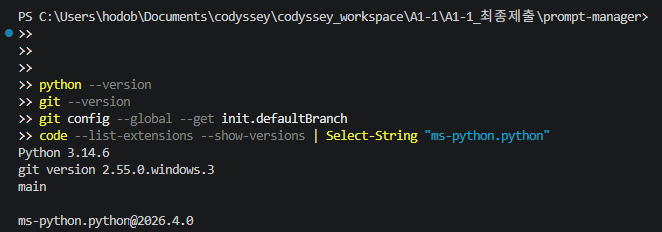

### Git 사용자 정보 명령 확인

PowerShell 터미널에서 아래 명령을 각각 직접 실행하여 Git 사용자 이름과 이메일 설정값을 확인했다.

```bash
git config --get user.name
git config --get user.email
```

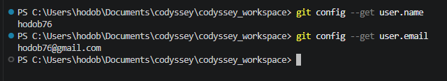

## 4. 프로그램 설계

### 4.1 데이터 구조

프롬프트 전체는 리스트로, 개별 프롬프트는 딕셔너리로 관리한다.

```python
{
    "title": "프롬프트 제목",
    "content": "프롬프트 전체 내용",
    "category": "이미지 생성",
    "favorite": False
}
```

기본 데이터 3개는 이전 JAPAN MATE 미션에서 실제 사용한 메인 홈페이지 UI, 패키지 검색 결과 UI, 오사카성 여행 이미지 프롬프트를 정리해 등록했다.

### 4.2 함수 분리

| 함수 | 역할 |
|---|---|
| `show_menu()` | 메인 메뉴 출력 |
| `input_nonempty()` | 빈 입력 방지 |
| `select_category()` | 기본 카테고리 선택 또는 직접 입력 |
| `add_prompt()` | 새 프롬프트 등록 |
| `show_prompt_list()` | 전체·필터 결과 목록 출력 |
| `show_by_category()` | 카테고리별 조회 |
| `search_prompts()` | 제목·내용 키워드 검색 |
| `show_prompt_detail()` | 번호로 전체 내용 조회 |
| `toggle_favorite()` | 즐겨찾기 추가·해제 |
| `show_favorites()` | 즐겨찾기 항목만 조회 |
| `load_prompts()` | UTF-8 JSON 불러오기 |
| `save_prompts()` | UTF-8 JSON 저장 |
| `export_markdown()` | 카테고리별 Markdown 내보내기 |
| `main()` | 메뉴 반복과 기능 연결 |

## 5. 필수 기능 실행 결과

증빙 이미지는 `prompt_manager.py`의 실제 `main()` 실행 결과를 캡처한 것이다. 입력한 값은 각 화면의 입력 프롬프트 뒤에서 확인할 수 있다.

### 5.1 메뉴와 종료

메인 페이지는 상단 현황, 중앙 최근 프롬프트, 하단 번호 메뉴로 구성된다. 터미널 폭과 높이를 반영하여 구분선과 메뉴 위치를 조정하며, 메뉴 번호를 입력해 기능을 선택한다. 잘못된 번호에는 안내 메시지를 출력하고 `0`을 선택하면 반복문을 종료한다.

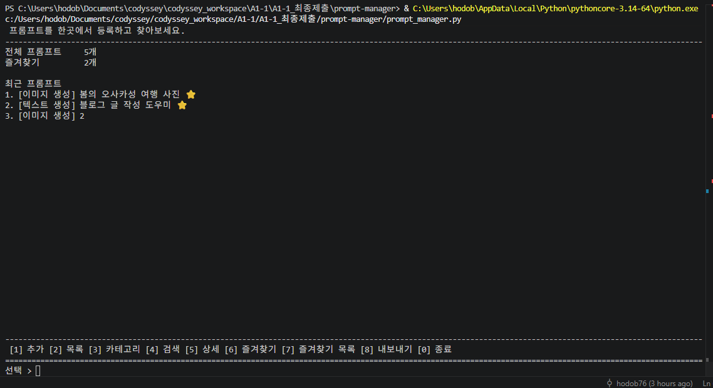

하단의 `선택 >` 입력란에서 `1`을 입력하여 프롬프트 추가 페이지로 이동하는 번호 선택 화면이다.

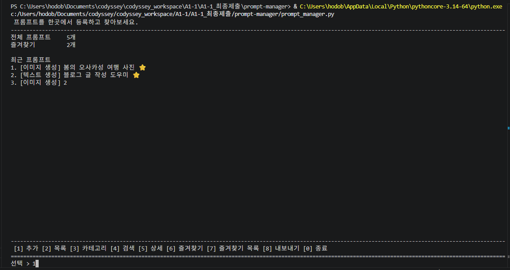

### 5.2 프롬프트 추가와 전체 목록

프롬프트 추가는 제목, 내용, 카테고리를 각각 독립된 페이지에서 입력하는 3단계 구조다. 모든 입력란과 선택 메뉴는 화면 하단에 고정되며 제목·내용의 빈 입력을 허용하지 않는다.

첫 번째 단계에서 새 프롬프트의 제목을 입력한다.

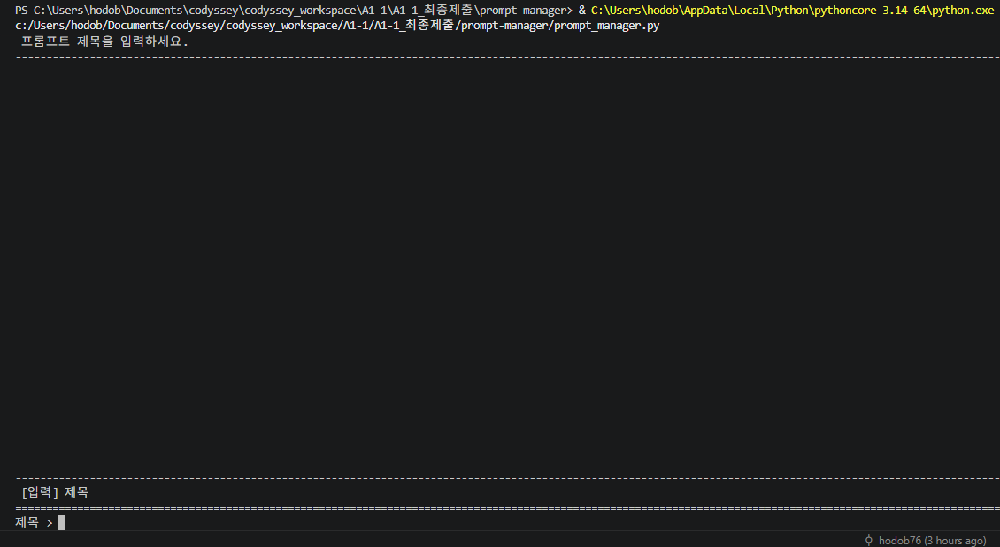

내용과 카테고리 입력을 마치면 제목, 카테고리, 즐겨찾기 기본값 `False`를 확인하는 완료 페이지를 표시한다.

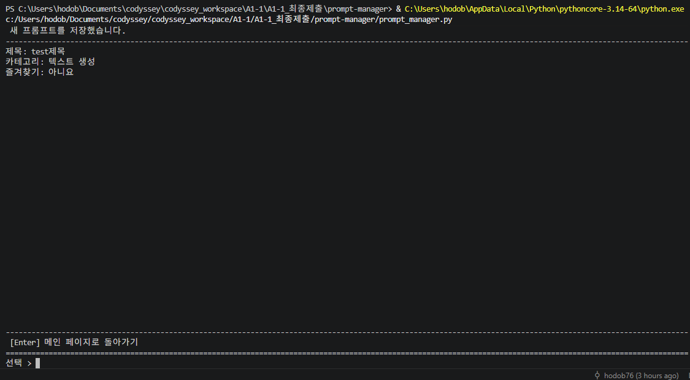

메인 페이지에서 전체 목록을 다시 조회하면 새로 등록한 `test제목` 항목이 6번에 반영된 것을 확인할 수 있다.

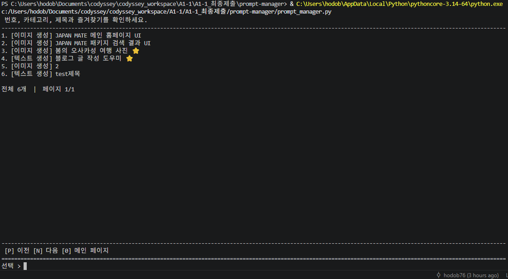

### 5.3 카테고리별 조회와 검색

선택한 카테고리의 프롬프트만 표시하며, 검색은 대소문자를 구분하지 않고 제목과 내용 모두를 대상으로 한다.

카테고리 조회 페이지에서는 하단 메뉴에서 조회할 카테고리를 번호로 선택할 수 있다.

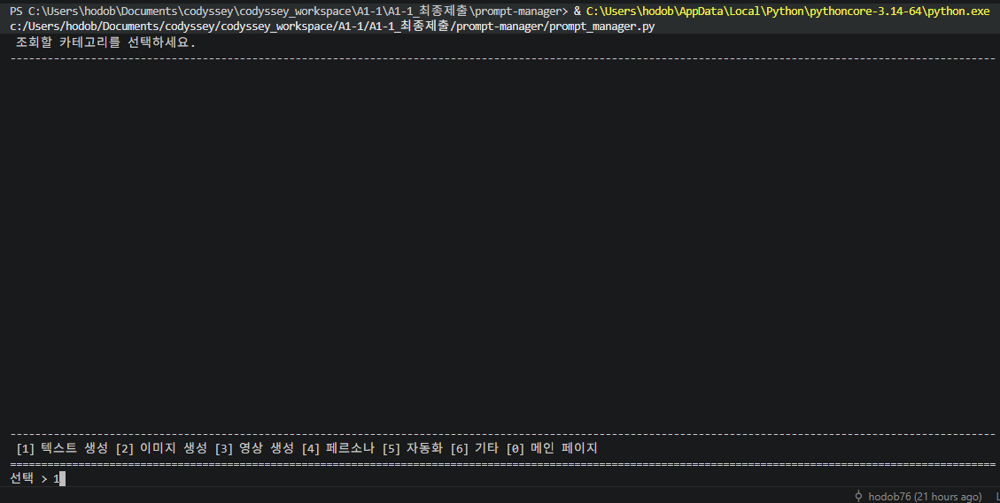

`텍스트 생성` 카테고리를 선택하면 해당 카테고리에 속한 프롬프트 2개만 표시된다.

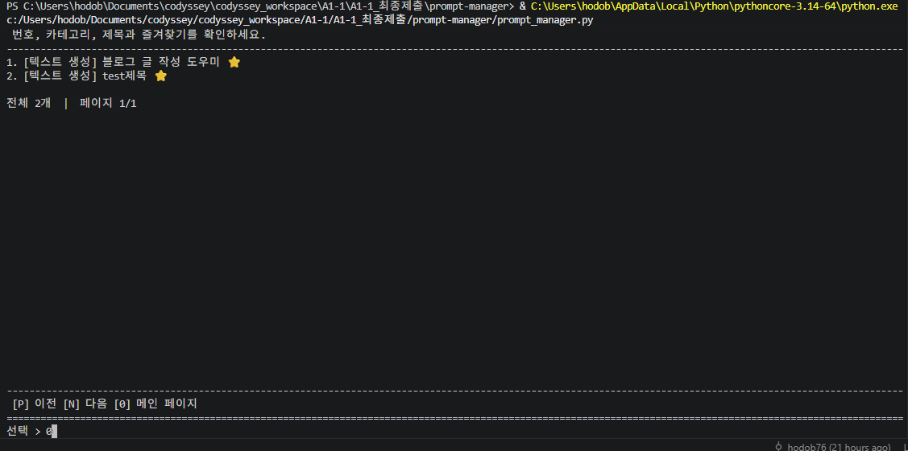

제목에 포함된 `봄의`를 검색어로 입력하면 `봄의 오사카성 여행 사진`이 조회된다.

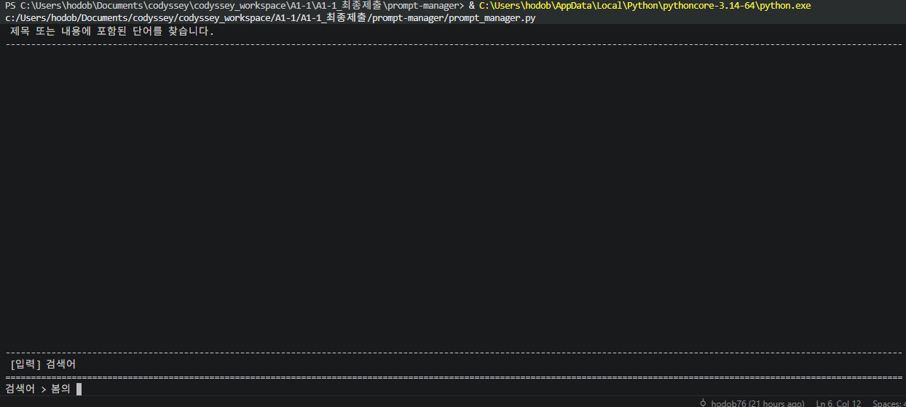

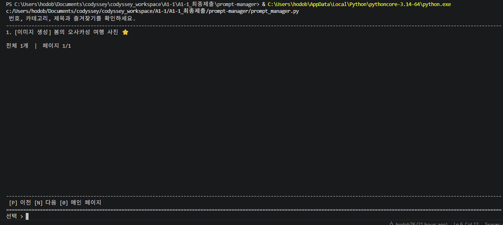

내용에만 포함된 `전문 블로거`를 검색어로 입력해도 `블로그 글 작성 도우미`가 조회된다. 이를 통해 검색 범위가 제목뿐 아니라 프롬프트 내용까지 포함함을 확인할 수 있다.

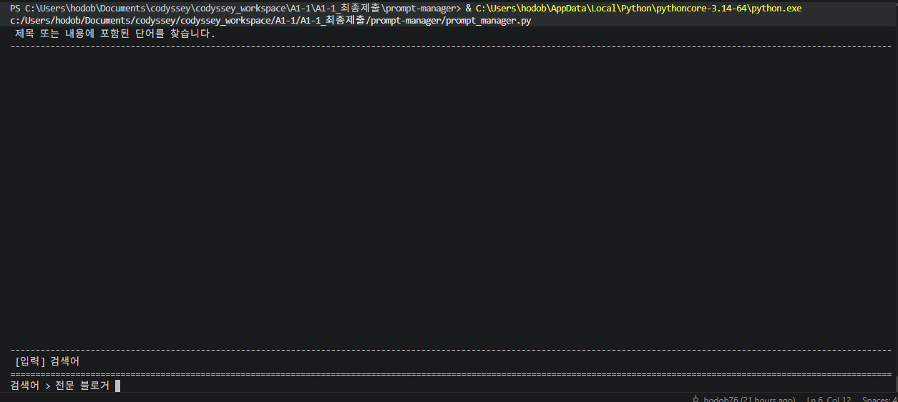

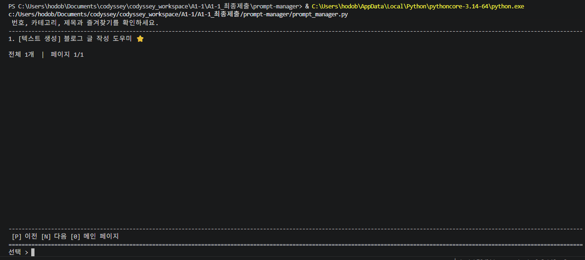

### 5.4 상세 보기와 즐겨찾기

사용자가 입력한 1부터 시작하는 번호를 리스트 인덱스로 변환하고 범위를 검증한다. 즐겨찾기는 `True`와 `False` 상태를 전환하며 즐겨찾기 목록만 별도로 표시한다.

상세 보기 페이지에서 현재 목록에 표시된 프롬프트 번호를 선택한다.

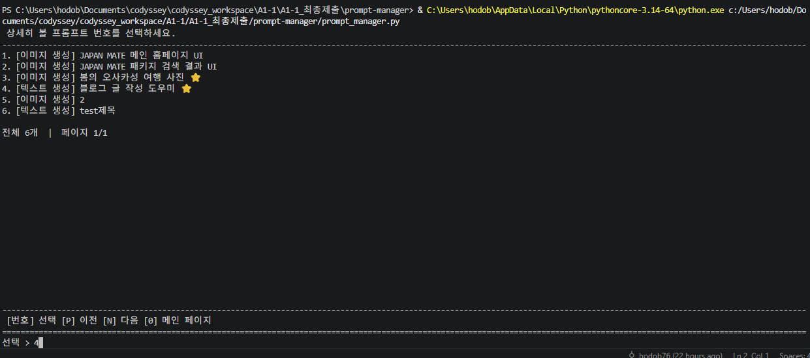

선택한 프롬프트의 제목, 카테고리, 즐겨찾기 여부와 전체 내용을 한 페이지에서 확인할 수 있다.

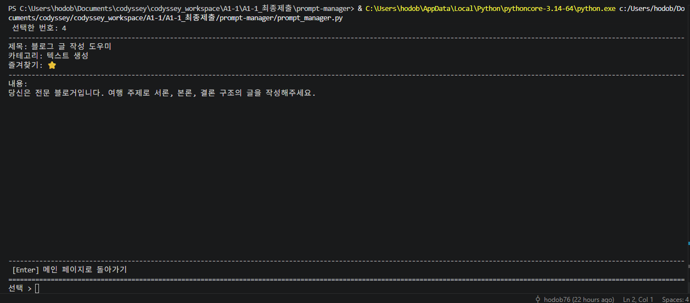

즐겨찾기 변경 페이지에서 전체 프롬프트 목록을 확인한 뒤 변경할 항목 번호를 선택한다.

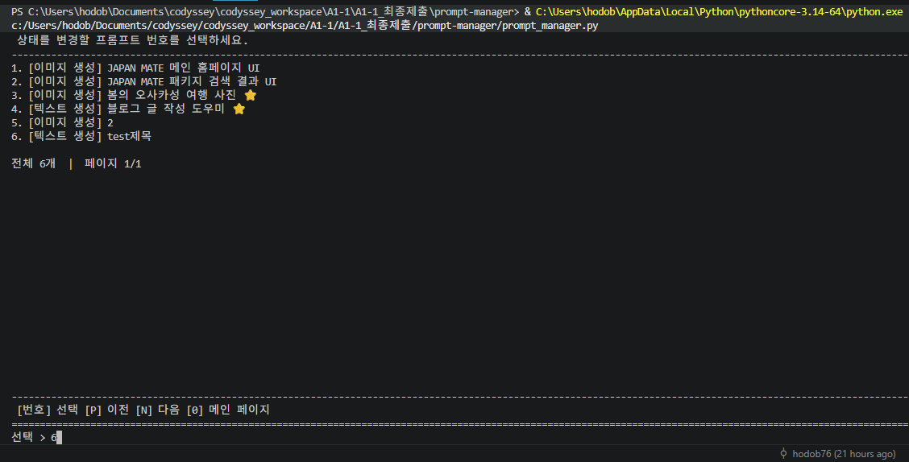

즐겨찾기 목록 페이지에서는 즐겨찾기 상태가 `True`인 프롬프트만 별도로 조회할 수 있다.

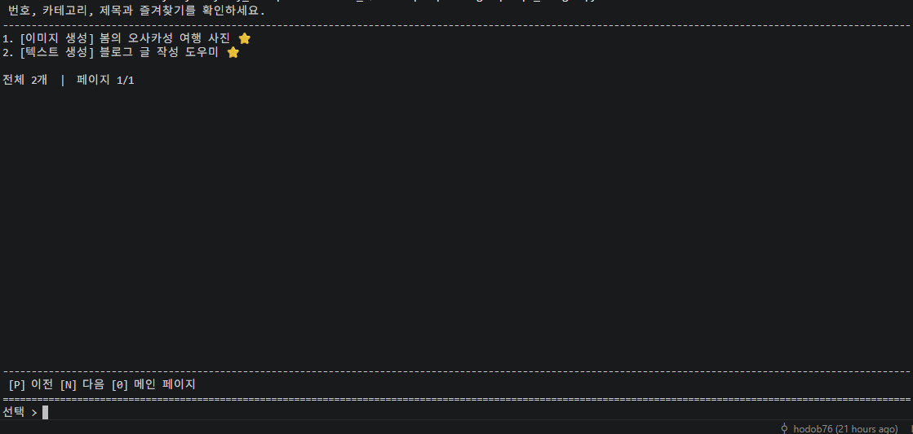

### 5.5 잘못된 입력과 빈 결과 처리

메인 페이지에 존재하지 않는 메뉴 번호를 입력하면 안내 메시지를 표시한 뒤 메뉴를 다시 보여준다.

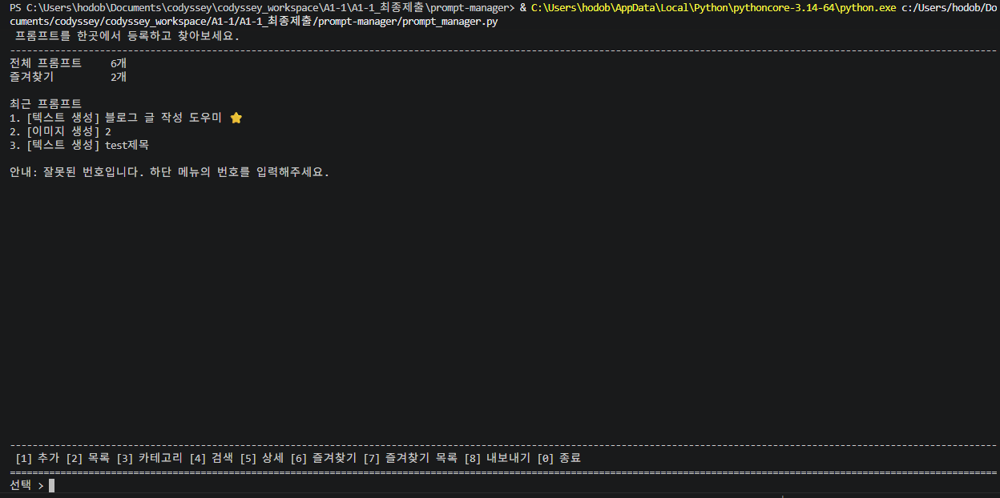

프롬프트 제목이나 내용을 입력하지 않고 Enter를 누르면 빈 값을 저장하지 않고 다시 입력하도록 안내한다. 아래 화면은 빈 제목을 입력한 경우이며 내용 입력에도 같은 검증을 적용한다.

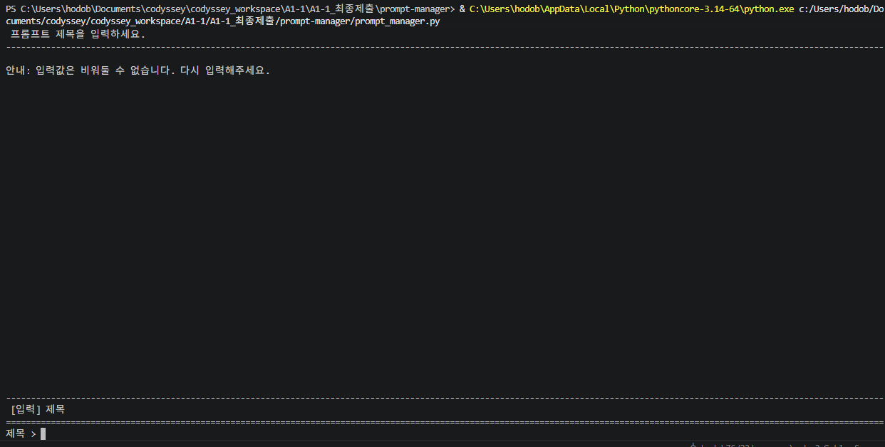

상세 보기에서 현재 페이지에 없는 프롬프트 번호를 입력하면 올바른 번호를 다시 입력하도록 안내한다.

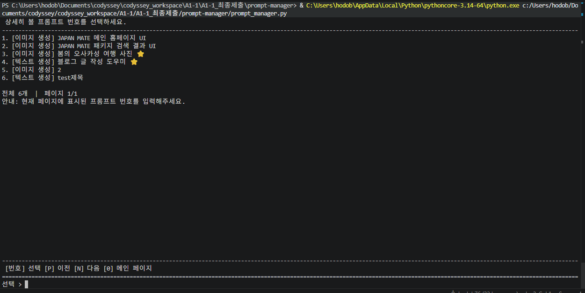

제목과 내용에 일치하는 항목이 없으면 빈 목록과 전체 `0개`를 표시한다.

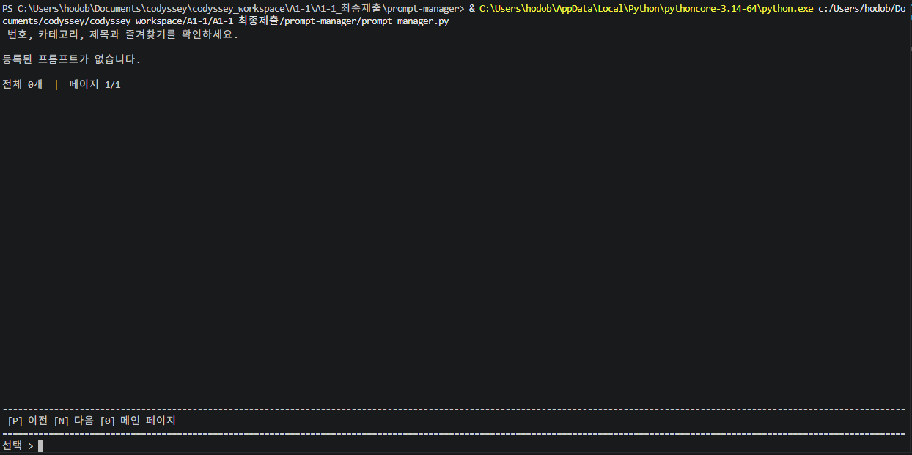

## 6. 보너스 1 구현 결과

### 6.1 JSON 저장 및 불러오기

- 데이터 파일: `prompts.json`
- 인코딩: UTF-8
- 최초 실행 시 JSON이 없으면 기본 데이터 3개로 생성
- 프롬프트 추가와 즐겨찾기 변경 시 즉시 저장
- 프로그램 종료 후 재실행해도 변경 데이터 유지
- 손상되거나 잘못된 구조의 JSON은 예외 처리 후 기본 데이터 사용

필수 기능에서 말하는 “프로그램 실행 중 유지”는 새 프롬프트를 먼저 메모리의 리스트에 추가하여 현재 실행에서 사용할 수 있어야 한다는 최소 기준이다. 본 프로젝트는 이 기준을 충족한 뒤 보너스 1을 적용하여 같은 리스트를 JSON 파일에도 저장하므로, 프로그램을 종료하고 다시 실행해도 데이터가 유지된다. 새 프롬프트의 즐겨찾기 기본값은 요구사항대로 `False`이다.

과제에서는 JSON을 저장하고 불러오는 시점을 별도로 지정하지 않았다. 따라서 별도의 수동 저장 메뉴를 두는 대신 데이터 손실을 방지하고 사용 절차를 단순화하기 위해 다음과 같은 자동 방식을 선택했다.

| 시점 | 처리 방식 |
|---|---|
| 프로그램 시작 | `prompts.json` 자동 불러오기 |
| 프롬프트 추가 | 리스트 반영 후 JSON 즉시 저장 |
| 즐겨찾기 변경 | 변경된 상태를 JSON에 즉시 저장 |
| 프로그램 종료 | 현재 리스트를 JSON에 한 번 더 저장 |

이 방식은 수동·반자동 방식보다 저장 누락 가능성이 작으며, 코드와 재실행 화면을 통해 JSON 저장·불러오기 기능을 확인할 수 있다.

### 6.2 카테고리별 Markdown 내보내기

- 출력 폴더: `exports/`
- 실제 데이터가 존재하는 카테고리마다 개별 `.md` 파일 생성
- 제목, 카테고리, 즐겨찾기 여부, 전체 내용을 포함
- Windows에서 사용할 수 없는 파일명 문자를 안전하게 변환

아래 화면에서 전체 프롬프트가 카테고리에 따라 `텍스트_생성.md`와 `이미지_생성.md` 두 파일로 내보내진 결과를 확인할 수 있다.

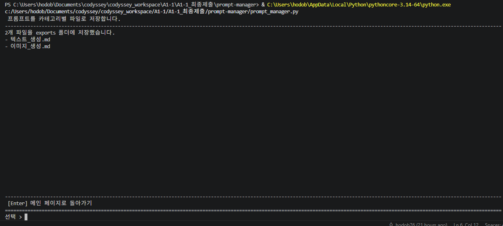

## 7. Git 및 GitHub 수행 결과

### 7.1 Git 명령 사용

| 필수 명령 | 수행 내용 |
|---|---|
| `init` | `prompt-manager` 독립 저장소 초기화 |
| `add` | 기능별 파일 스테이징 |
| `commit` | 기능 단위 의미 있는 커밋 10개 이상 작성 |
| `push` | `main`, `feature/prompt-list`를 GitHub에 업로드 |
| `pull` | `git pull --ff-only origin main`, 최신 상태 확인 |
| `checkout` | 기능 브랜치 생성과 `main` 복귀 |
| `clone` | 공개 `octocat/Hello-World` 저장소 실제 복제·확인 |
| `merge` | `feature/prompt-list`를 `main`에 `--no-ff` 병합 |

공개 샘플 저장소 clone 수행 기록은 `a10f6b7` 커밋 이력에서 확인할 수 있으며, 확인에 사용한 임시 문서는 최종 제출 파일 정리 과정에서 삭제했다.

### 7.2 GitHub 저장소 생성

GitHub에 `A1-1-prompt-manager` 공개 저장소를 새로 생성하고 원격 저장소 주소를 확인했다.

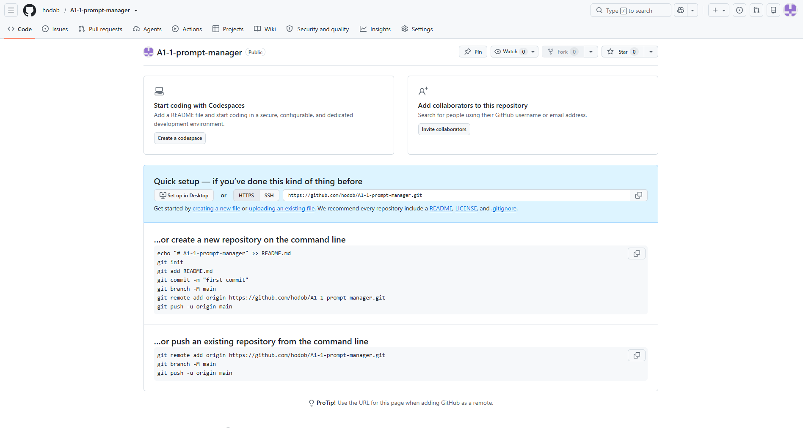

### 7.3 코드 업로드와 병합 그래프

GitHub 저장소는 <https://github.com/hodob/A1-1-prompt-manager>이며, 원격에 `main`과 `feature/prompt-list` 브랜치가 업로드되어 있다.

아래 화면에서 `main` 브랜치의 프로그램 코드, `README.md`, 데이터 및 2개 브랜치가 GitHub에 업로드된 것을 확인할 수 있다.

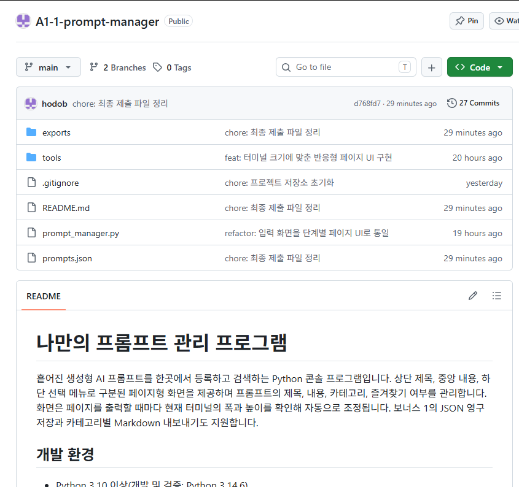

목록 기능은 `feature/prompt-list` 브랜치의 `c9e56ef` 커밋에서 구현한 뒤 `ad146b0` 병합 커밋으로 `main`에 합쳤다.

아래 실제 터미널의 `git log --oneline --graph` 결과에서 10개 이상의 기능 단위 커밋, 기능 브랜치와 `main`의 병합 구조를 확인할 수 있다.

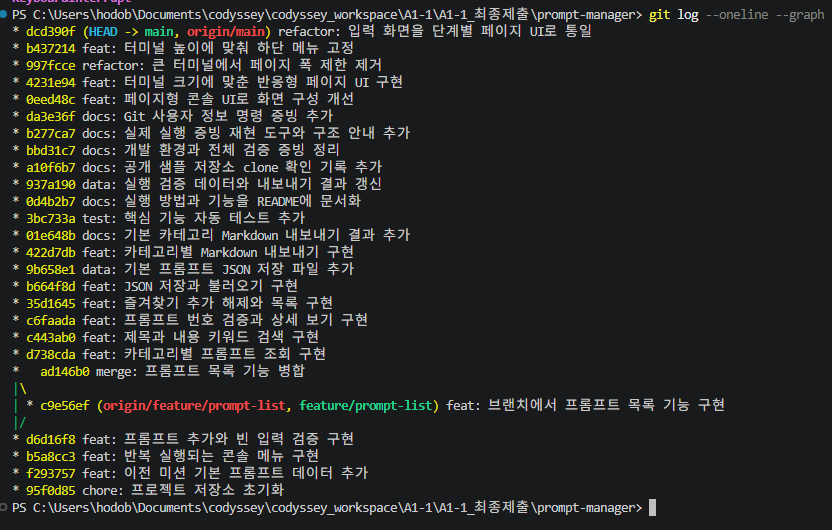

## 8. 요구사항 자체 평가표

| 평가 항목 | 결과 | 주요 증빙 |
|---|---:|---|
| Python 3.10 이상 | 충족 | Python 3.14.6, 개발 환경 화면 |
| Git 버전과 사용자 정보 | 충족 | Git 2.55.0, 환경 확인 문서 |
| VSCode Python 확장 | 충족 | `ms-python.python@2026.4.0` |
| GitHub URL 및 코드 업로드 | 충족 | 공개 저장소 URL, `origin/main` |
| 공개 샘플 저장소 clone | 충족 | 수행 기록 커밋 `a10f6b7` |
| 메뉴와 번호 선택 | 충족 | 메인 메뉴 실행 화면 |
| 잘못된 입력 처리 | 충족 | 잘못된 메뉴·빈 입력·잘못된 번호 실행 화면 |
| 기본 프롬프트 3개 이상 | 충족 | JAPAN MATE 실제 프롬프트 3개 |
| 프롬프트 추가 | 충족 | 추가 후 6개 목록 화면 |
| 전체 목록 | 충족 | 제목·카테고리·⭐ 표시 |
| 카테고리별 조회 | 충족 | 텍스트 생성 항목 2개 필터 화면 |
| 제목 또는 내용 검색 | 충족 | 제목·내용 검색과 검색 결과 없음 화면 |
| 상세 보기 | 충족 | 제목·카테고리·즐겨찾기·전체 내용 표시 |
| 즐겨찾기 추가·해제 | 충족 | 상태 전환과 즐겨찾기 목록 화면 |
| 함수별 코드 분리 | 충족 | 37개 기능 함수 |
| JSON 영구 저장 | 충족 | `prompts.json` 저장·불러오기 구현 |
| Markdown 내보내기 | 충족 | 카테고리별 2개 파일 생성 화면 |
| README 작성 | 충족 | 설명, 실행법, 기능, 카테고리 문서화 |
| 커밋 10개 이상 | 충족 | 기능 단위 커밋과 그래프 |
| 브랜치 생성·병합 | 충족 | `feature/prompt-list`, `ad146b0` |

## 9. 프로젝트 README.md

### 9.1 프로그램 소개

흩어진 생성형 AI 프롬프트를 한곳에서 등록하고 검색하는 Python 콘솔 프로그램이다. 상단 제목, 중앙 내용, 하단 선택 메뉴로 구분된 페이지형 화면을 제공하며 프롬프트의 제목, 내용, 카테고리, 즐겨찾기 여부를 관리한다. 화면은 페이지를 출력할 때마다 현재 터미널의 폭과 높이를 확인해 자동으로 조정된다. 보너스 1의 JSON 영구 저장과 카테고리별 Markdown 내보내기도 지원한다.

### 9.2 개발 환경

- Python 3.10 이상(개발 및 검증: Python 3.14.6)
- Git(개발 및 검증: Git 2.55.0.windows.3)
- 외부 Python 라이브러리 사용 안 함

### 9.3 실행 방법

1. 저장소를 내려받는다.

   ```bash
   git clone https://github.com/hodob/A1-1-prompt-manager.git
   cd A1-1-prompt-manager
   ```

2. 프로그램을 실행한다.

   ```bash
   python prompt_manager.py
   ```

3. 메인 페이지 하단의 번호를 입력해 원하는 기능을 사용한다. 목록이 여러 페이지이면 `P`와 `N`으로 이전·다음 페이지를 이동하고 `0`으로 메인 페이지에 돌아간다. 일반 결과 페이지에서는 `Enter`를 누르면 메인 페이지로 돌아가며, 메인 페이지에서 `0`을 입력하면 종료된다.

### 9.4 기능

1. 프롬프트 추가
2. 전체 프롬프트 목록 보기
3. 카테고리별 조회
4. 제목 또는 내용 키워드 검색
5. 프롬프트 상세 보기
6. 즐겨찾기 추가 및 해제
7. 즐겨찾기 목록 보기
8. 카테고리별 Markdown 파일 내보내기
9. JSON 자동 저장 및 시작 시 불러오기(보너스 1)
10. 빈 입력, 잘못된 메뉴와 프롬프트 번호 검증
11. 최대 폭 제한 없이 터미널 너비에 따라 줄바꿈과 메뉴 행이 달라지는 반응형 화면
12. 터미널 높이에 따라 목록 수를 조정하고 선택 메뉴를 마지막 행에 배치
13. 목록 페이지의 이전·다음·메인 페이지 이동
14. 제목·내용·카테고리를 독립 페이지에서 입력하는 3단계 추가 화면

### 9.5 데이터와 카테고리

프롬프트는 리스트 안의 딕셔너리로 관리한다.

```python
{
    "title": "프롬프트 제목",
    "content": "프롬프트 전체 내용",
    "category": "이미지 생성",
    "favorite": False
}
```

기본 카테고리는 다음과 같다.

- 텍스트 생성
- 이미지 생성
- 영상 생성
- 페르소나
- 자동화
- 기타

사용자는 프롬프트를 추가할 때 새로운 카테고리를 직접 입력할 수도 있다.

### 9.6 보너스 1

- 프로그램 시작 시 `prompts.json`을 UTF-8로 읽는다.
- 프롬프트 추가와 즐겨찾기 변경 시 JSON에 자동 저장한다.
- JSON이 처음부터 없으면 기본 프롬프트 3개로 새 파일을 생성한다.
- 메뉴 8번을 실행하면 `exports` 폴더에 카테고리별 Markdown 파일을 생성한다.

### 9.7 파일 구조

```text
prompt-manager/
├── prompt_manager.py       # 프로그램 소스코드
├── prompts.json            # 영구 저장 데이터
├── exports/                # Markdown 내보내기 결과
├── tools/                  # 실행 증빙 재현 도구
├── README.md
└── .gitignore
```

### 9.8 기본 데이터 출처

기본 프롬프트 3개는 이전에 수행한 JAPAN MATE 프로젝트에서 실제 사용한 메인 UI, 검색 결과 UI, 오사카성 여행 이미지 프롬프트를 정리하여 등록했다.
