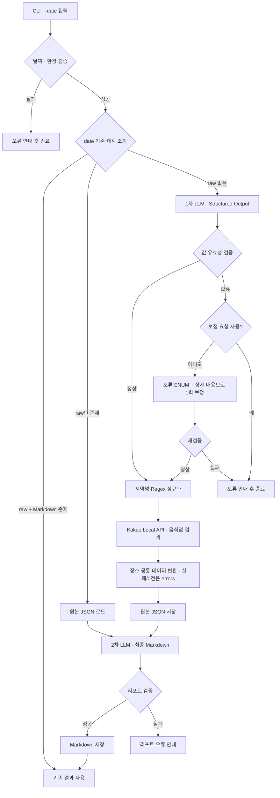

# 국내 여행지 추천 프로그램

여행 날짜를 입력하면 LLM이 국내 여행지를 추천하고, 추천 지역을 기반으로 Kakao Local API에서 음식점을 검색한 뒤 최종 여행 리포트를 생성하는 Python 프로그램이다.

## 1. 주요 기능 및 구현 범위

| 구분 | 구현 내용 |
|---|---|
| CLI | `-date "YYYY-MM-DD"` 필수 입력 및 날짜 유효성 검증 |
| 여행지 추천 | LLM으로 추천 지역, 날씨, 행사 후보, 추천 이유 생성 |
| 구조화 응답 | Provider의 Structured Output(`json_schema`, `strict: true`) 사용 |
| 장소 검색 | `recommended_city`를 정규화하여 Kakao Local API 음식점 검색 |
| 최종 리포트 | 2차 LLM이 Markdown 전체를 생성하고 Python은 검증 후 그대로 저장 |
| 오류 처리 | 오류 ENUM과 상세 내용을 관리하고 추천 값 검증 실패 시 1회 보정 요청 |
| 결과 저장 | 원본 JSON과 최종 Markdown을 `results/`에 저장 |
| 캐싱 | 같은 날짜의 원본 JSON과 Markdown을 재사용하여 외부 API 호출 최소화 |
| UI | 터미널에서는 TUI를 기본 사용하며 `--no-tui`로 일반 CLI 실행 가능 |

- Python 3.10 이상
- LLM: Groq OpenAI-compatible API (`openai/gpt-oss-120b`)
- 장소 검색: Kakao Local API

## 2. 설치 및 실행

의존성을 설치한다.

```bash
pip install -r requirements.txt
```

프로젝트 루트에 `.env` 파일을 만들고 API 키를 설정한다.

```dotenv
LLM_API_KEY=YOUR_LLM_API_KEY
KAKAO_API_KEY=YOUR_KAKAO_API_KEY
```

API 키는 `.env`로 관리하며 실제 키 값은 제출물에 포함하지 않는다. 코드와 인증 정보를 분리해 키 노출 위험을 줄이고, 키 교체 시 코드 수정이 필요하지 않도록 한다.

기본 실행은 TUI를 사용한다.

```bash
python main.py -date "2026-10-15"
```

일반 CLI 출력으로 실행하려면 `--no-tui`를 사용한다.

```bash
python main.py -date "2026-10-15" --no-tui
```

`-date`는 필수 옵션이며 `YYYY-MM-DD` 형식과 실제 달력 날짜를 모두 검증한다. 비대화형 터미널에서는 TUI 대신 일반 CLI 모드로 실행된다.

## 3. 전체 실행 흐름



## 4. 모듈 구조와 데이터 전달

| 파일 | 핵심 함수/클래스 | 책임 |
|---|---|---|
| `main.py` | `parse_date()`, `main()` | 날짜 검증, TUI/CLI 모드 선택 |
| `src/config.py` | `load_config()` | `.env`·`config.yml` 검증 및 로드 |
| `src/models.py` | `parse_recommendation()`, `ErrorType` | Structured Output 값 검증·공통 데이터 계약 |
| `src/llm.py` | `LLMClient.complete()` | OpenAI-compatible Chat Completions POST 요청 |
| `src/places.py` | `normalize_region()`, `KakaoPlaces.search()` | 지역명 정규화·Kakao 음식점 검색 |
| `src/prompts.py` | `recommendation_messages()`, `report_messages()` | 1차 추천·보정·2차 리포트 지시 구성 |
| `src/pipeline.py` | `run_pipeline()` | 공통 파이프라인·캐시 분기 제어 |
| `src/report.py` | `finalize_report()` | 2차 LLM Markdown의 구조·필수 값 검증 |
| `src/storage.py` | `load_raw()`, `save_raw()`, `save_report()` | 날짜별 JSON/Markdown 로드·저장 |
| `src/tui.py` | `TravelApp`, `run_tui()` | 자동 실행 TUI 표현 계층 |
| `src/console.py` | `TravelConsole` | `--no-tui` 진행 로그·결과 경로 출력 |

핵심 데이터는 다음 순서로 전달된다.

```text
date
→ recommendation
→ recommended_city
→ places
→ recommendation + places + errors
→ final Markdown
```

TUI와 일반 CLI는 서로 다른 비즈니스 로직을 갖지 않고 동일한 `run_pipeline()`을 호출한다. 장소 제공자는 `PlaceProvider` 인터페이스 뒤에 분리되어 있어 Kakao 외 제공자로 교체할 경우 장소 모듈의 구현 범위를 중심으로 변경할 수 있다.

## 5. 데이터 구조 및 검증 설계

1차 LLM 출력은 다음 단계에서 직접 사용할 수 있도록 JSON으로 구조화한다.

JSON은 **ISO/IEC 21778:2017**로 표준화된 데이터 교환 형식이다. 본 프로그램은 Provider가 지원하는 Structured Output의 `json_schema`와 `strict: true`를 사용하여 다음 JSON 구조를 따르도록 보장한다.

```json
{
  "recommended_city": "경상북도 경주시",
  "weather": "10월 중순은 비교적 선선하며 일교차가 있습니다.",
  "events": ["지역 행사 후보"],
  "reason": "가을 여행에 적합한 지역입니다."
}
```

필수 데이터 계약은 다음과 같다.

- `recommended_city`: `string`
- `weather`: `string`
- `events`: `array[string]`
- `reason`: `string`

Provider가 JSON 구조를 보장한 뒤 애플리케이션에서는 실제 사용 가능한 값인지 추가 검증한다. 필수 문자열의 빈 값 여부와 `events`의 1~3개 제한 등을 확인한다.

표준화된 JSON 형식과 명시적인 검증 규칙을 사용하여 **Compatibility (호환성), Flexibility (유연성), Maintainability (유지보수성), Reliability (신뢰성)** 등의 소프트웨어 품질 향상을 고려하였다.

## 6. API 및 검색 설계

요청 목적과 HTTP Method의 의미가 일치하도록 RESTful 원칙을 적용한다.

| 대상 | Method | 목적 |
|---|---|---|
| LLM API | `POST` | 프롬프트와 입력 데이터를 전달해 새로운 결과 생성 |
| Kakao Local API | `GET` | 검색 조건에 해당하는 기존 장소 정보 조회 |

### 지역명 파싱

`recommended_city`는 Kakao API에 전달하기 전에 Regex로 행정구역을 정규화한다.

```regex
[가-힣]+?(?:특별자치도|특별자치시|특별시|광역시|도|시|군|구)
```

처리 규칙은 다음과 같다.

1. 앞뒤 공백과 중복 공백을 제거한다.
2. Regex로 도·시·군·구 등 행정구역을 원래 순서대로 추출한다.
3. 동일한 행정구역이 반복되면 중복을 제거한다.
4. 행정구역 패턴이 없으면 정리된 원본 지역명을 사용한다.
5. 최종 지역명에 `음식점`을 결합하여 검색어를 생성한다.

```text
"경상북도 경주시"
→ ["경상북도", "경주시"]
→ "경상북도 경주시 음식점"
```

## 7. 오류 처리 및 복구

설정, 외부 API, 응답 검증, 저장 오류를 `AppError`와 `ErrorType` ENUM으로 분류한다. 파이프라인 실행 결과가 생성된 뒤 발생한 오류는 `errors`에 누적한다.

| 분류 | 오류코드 | 발생 조건 | 처리 |
|---|---|---|---|
| 설정 | `CONFIG_ERROR` | `.env`·`config.yml` 누락, 형식 오류 또는 잘못된 설정값 | API 호출 없이 종료 |
| HTTP | `AUTH_ERROR` | HTTP 401·403 인증 실패 | 1차 LLM이면 종료, Kakao이면 빈 목록으로 계속 |
| HTTP | `QUOTA_ERROR` | HTTP 429 사용량·요청 횟수 제한 | 1차 LLM이면 종료, Kakao이면 빈 목록으로 계속 |
| HTTP | `TIMEOUT` | 외부 API 응답 시간 초과 | 1차 LLM이면 종료, Kakao이면 빈 목록으로 계속 |
| HTTP | `NETWORK_ERROR` | 외부 API 연결 실패 | 1차 LLM이면 종료, Kakao이면 빈 목록으로 계속 |
| HTTP | `REQUEST_ERROR` | HTTP 400·404 요청 주소 또는 형식 오류 | 1차 LLM이면 종료, Kakao이면 빈 목록으로 계속 |
| HTTP | `INPUT_TOO_LARGE` | HTTP 413 입력 크기·토큰 한도 초과 | 1차 LLM이면 종료, Kakao이면 빈 목록으로 계속 |
| HTTP | `REDIRECT_ERROR` | HTTP 3xx 리다이렉트 응답 | 1차 LLM이면 종료, Kakao이면 빈 목록으로 계속 |
| HTTP | `HTTP_ERROR` | 별도로 분류하지 않은 HTTP 오류 | 1차 LLM이면 종료, Kakao이면 빈 목록으로 계속 |
| 응답 | `RESPONSE_ERROR` | API 응답 본문을 JSON으로 읽을 수 없거나 필수 응답 구조가 없음 | 1차 LLM이면 JSON 재요청 1회, Kakao이면 빈 목록으로 계속 |
| LLM | `REFUSAL` | 모델이 응답 생성을 거부함 | 종료 |
| LLM | `TRUNCATED` | 토큰 한도로 모델 응답이 중단됨 | 1차 LLM이면 JSON 재요청 1회, 최종 리포트이면 종료 |
| LLM | `INCOMPLETE` | 모델 응답이 정상 완료 상태가 아님 | 종료 |
| LLM | `EMPTY_RESPONSE` | 모델 응답 내용이 비어 있음 | 종료 |
| 추천값 | `EMPTY_REQUIRED_VALUE` | 추천 도시·날씨·이유 또는 행사 문자열이 비어 있음 | JSON 재요청 1회 |
| 추천값 | `INVALID_FIELD_VALUE` | 행사 후보 개수가 1~3개 범위를 벗어남 | JSON 재요청 1회 |
| 추천값 | `CITY_ERROR` | 추천 지역명이 비어 있거나 검색어로 사용하기에 지나치게 김 | JSON 재요청 1회 |
| 장소 | `EMPTY_RESULT` | 사용할 수 있는 음식점 검색 결과가 0건임 | `errors`에 기록하고 빈 목록으로 계속 |
| 장소 | `PLACE_DATA_WARNING` | 장소 항목의 이름·주소·링크·좌표 일부가 유효하지 않음 | 해당 항목 또는 필드만 제외하고 계속 |
| 리포트 | `REPORT_FORMAT_ERROR` | 최종 Markdown의 제목·섹션·원본 데이터 반영 규칙 위반 | 원본 JSON을 유지하고 종료 |
| 캐시 | `CACHE_ERROR` | 원본 JSON 또는 Markdown 캐시를 읽을 수 없음 | 원본 JSON 오류이면 종료, Markdown 오류이면 리포트 재생성 |
| 저장 | `SAVE_ERROR` | 원본 JSON 또는 Markdown을 저장할 수 없음 | 종료 |
| 실행 | `INTERRUPTED` | TUI에서 사용자가 실행을 중단함 | 종료 |

### 불완전 JSON 파싱과 재요청

1차 LLM에는 `json_schema`와 `strict: true`를 적용해 응답 구조를 제한한다. 그럼에도 응답 누락이나 비정상 종료에 대비해 다음 순서로 파싱하고 검증한다.

1. 모델 응답의 완료 상태를 확인한다. 거부, 토큰 한도 중단, 비정상 종료, 빈 응답을 각각 `REFUSAL`, `TRUNCATED`, `INCOMPLETE`, `EMPTY_RESPONSE`로 분류한다.
2. 완료된 응답은 `json.loads()`로 파싱한다. JSON 문법이 깨졌거나 필수 키·타입을 추천 데이터로 변환할 수 없으면 `RESPONSE_ERROR`로 분류한다. 문자열 치환이나 일부 필드 추출로 깨진 JSON을 임의 복구하지 않는다.
3. 파싱된 값의 필수 문자열, 행사 개수·내용, 검색 가능한 지역명을 검사하고 `EMPTY_REQUIRED_VALUE`, `INVALID_FIELD_VALUE`, `CITY_ERROR`로 분류한다.
4. `RESPONSE_ERROR`, `TRUNCATED`, `EMPTY_REQUIRED_VALUE`, `INVALID_FIELD_VALUE`, `CITY_ERROR`이면 오류 종류와 원인을 넣어 전체 JSON을 최대 1회 다시 생성하도록 요청한다. 검증에 사용한 이전 응답이 있으면 보정 문맥에 함께 포함한다.

보정 요청은 최초 요청의 `system`·`user` 메시지 뒤에 검증에 실패한 응답을 `assistant` 메시지로 넣고, 이어서 오류 정보가 담긴 `user` 메시지를 추가한다. 최초 요청과 동일한 Structured Output 스키마로 다시 `POST`하며, 요청 구조의 인증키와 긴 메시지는 자리표시자로 줄였다.

```http
POST https://api.groq.com/openai/v1/chat/completions
Authorization: Bearer <LLM_API_KEY>
Content-Type: application/json

{
  "model": "openai/gpt-oss-120b",
  "messages": [
    {
      "role": "system",
      "content": "{기본 시스템 프롬프트}"
    },
    {
      "role": "user",
      "content": "{날짜를 포함한 기본 요청 내용}"
    },
    {
      "role": "assistant",
      "content": "{검증에 실패한 이전 응답}"
    },
    {
      "role": "user",
      "content": "{아래 보정 요청 내용}"
    }
  ],
  "max_tokens": 4096,
  "stream": false,
  "response_format": {
    "type": "json_schema",
    "json_schema": {
      "name": "travel_recommendation",
      "strict": true,
      "schema": {
        "type": "object",
        "properties": {
          "recommended_city": {"type": "string"},
          "weather": {"type": "string"},
          "events": {
            "type": "array",
            "items": {"type": "string"}
          },
          "reason": {"type": "string"}
        },
        "required": ["recommended_city", "weather", "events", "reason"],
        "additionalProperties": false
      }
    }
  }
}
```

위 요청의 네 번째 `content`에는 다음과 같은 여러 줄 문자열이 들어간다.

```text
이전 생성 결과가 다음 검증 오류로 거부되었습니다. 오류와 요구 구조를 반영하여 전체 JSON을 다시 생성하세요.
error_type: RESPONSE_ERROR
error_detail: 구조화 응답을 추천 데이터로 읽을 수 없습니다.
required_schema:
- recommended_city: string
- weather: string
- events: array[string], 1~3개
- reason: string
```

`error_type`에는 실제로 발생한 ENUM 값이, `error_detail`에는 해당 검증 실패 원인이 들어간다. `required_schema`는 모델이 수정해야 할 필드와 값 조건을 다시 알려주며, `response_format`은 응답 자체를 동일한 JSON Schema로 제한한다. 이전 응답은 API 키 필터링을 거친 값만 사용한다. API 응답에서 모델 답변을 찾지 못했거나 토큰 한도로 응답이 중단된 경우에는 전달할 정상 응답이 없으므로 `assistant` 메시지를 생략하고 오류 정보만 보낸다. HTTP 제한 시간 120초는 요청 본문이 아니라 클라이언트 옵션으로 적용한다.

재응답에도 완료 상태 확인, `json.loads()` 파싱, 값 검증을 동일하게 적용한다. 두 번째 응답도 실패하면 Kakao 검색을 호출하지 않고 실행을 종료하므로 무한 재시도는 발생하지 않는다.

Kakao 검색 실패는 전체 실행을 중단하지 않는다. 오류를 `errors`에 기록하고 `places=[]`로 최종 리포트 생성을 계속한다. 401·403 오류는 API 키 설정 → 인증 헤더 방식·이름 → Provider 권한·접근 설정 순서로 확인하며 키 값은 출력하지 않는다.

## 8. 결과물

실행 결과는 `results/`에 저장한다.

```text
results/
├── <date>_raw.json
└── <date>_travel_plan.md
```

원본 JSON에는 1차 추천 결과, 음식점 검색 결과, 오류 목록을 저장한다.

```json
{
  "date": "2026-10-15",
  "recommendation": {
    "recommended_city": "경상북도 경주시",
    "weather": "...",
    "events": ["..."],
    "reason": "..."
  },
  "places": [],
  "errors": []
}
```

최종 Markdown에는 추천 지역과 이유, 날씨, 행사·축제, 음식점, 오전·오후·저녁 수준의 1일 일정, 오류 요약을 포함한다. 음식점 검색 결과가 없으면 `데이터 없음`으로 표시한다.

## 9. 결과 캐싱

과제에서 요구하는 원본 JSON 파일 자체를 캐시로 사용한다.

| 저장 상태 | 실행 |
|---|---|
| 원본 JSON 없음 | 추천 LLM → Kakao 검색 → 원본 JSON 저장 → 최종 LLM |
| 원본 JSON 있음 / Markdown 없음 | 추천 LLM과 Kakao 호출을 생략하고 최종 LLM만 호출 |
| 원본 JSON 있음 / Markdown 있음 | 외부 API 호출 없이 기존 결과 사용 |

별도의 SQLite나 외부 캐시 저장소를 두지 않아 제출 산출물과 캐시를 하나의 데이터로 유지한다.

## 10. 프로젝트 구조

```text
.
├── main.py
├── config.yml
├── requirements.txt
├── .env.example
├── run_travel_planner.ps1
├── src/
│   ├── config.py
│   ├── console.py
│   ├── http.py
│   ├── llm.py
│   ├── llm_input.py
│   ├── models.py
│   ├── pipeline.py
│   ├── places.py
│   ├── prompts.py
│   ├── report.py
│   ├── safety.py
│   ├── storage.py
│   ├── terminal.py
│   ├── tui.py
│   └── tui.tcss
├── tests/
└── results/
```
