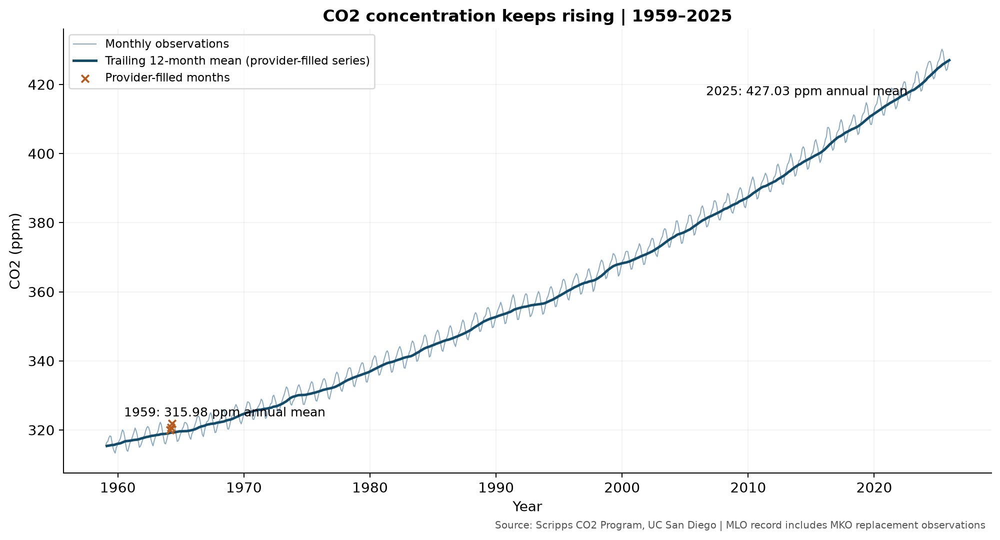
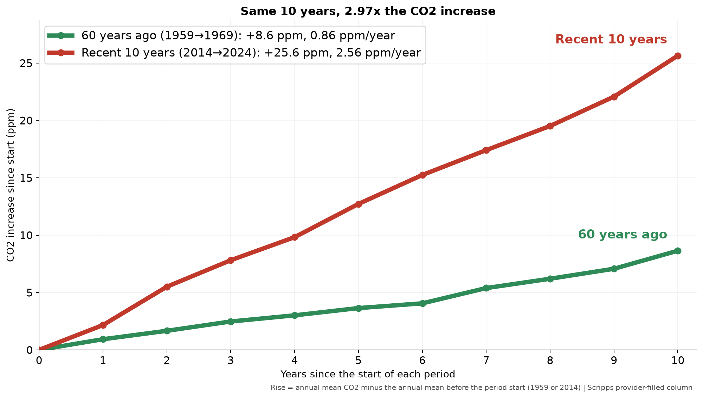
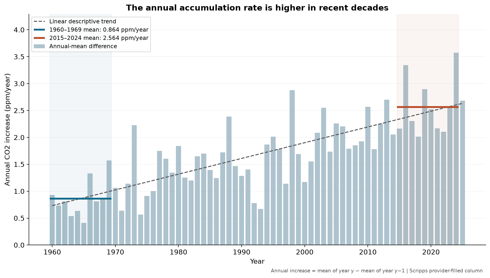
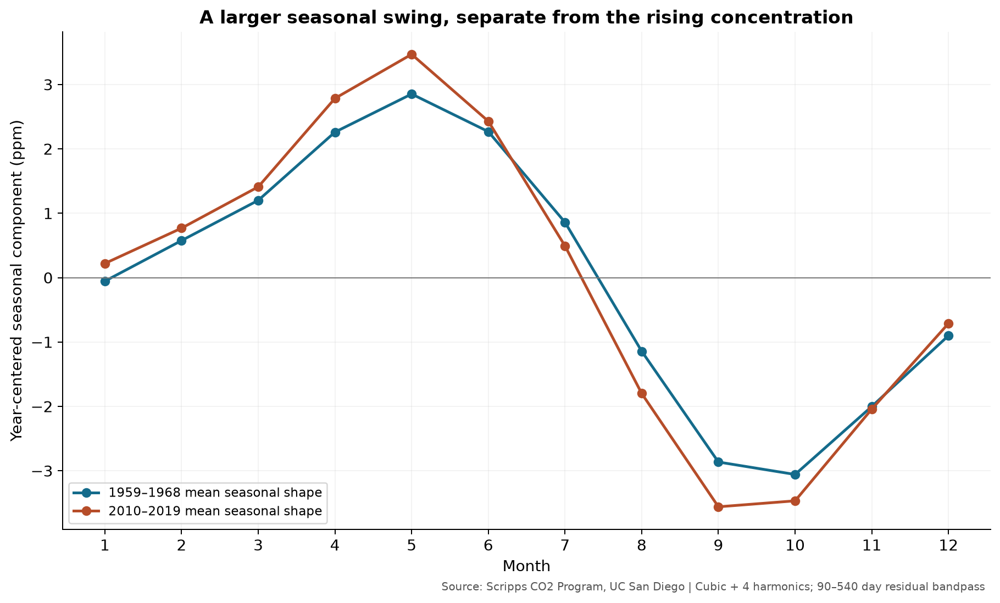
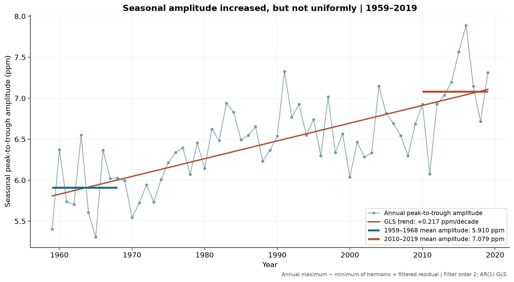
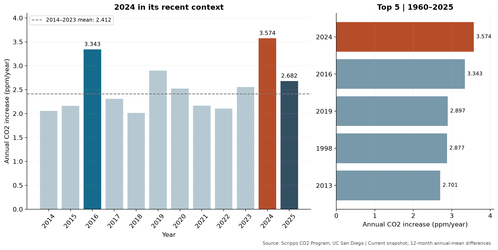
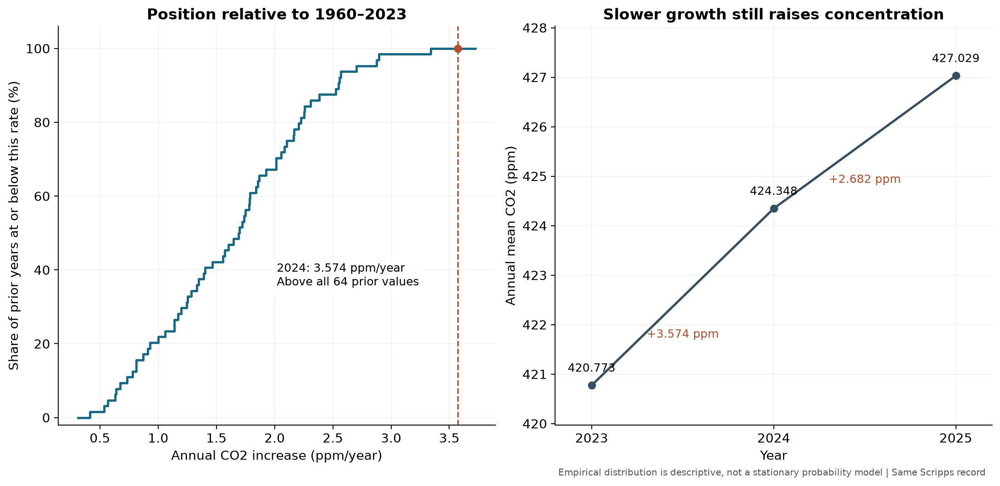

# 마우나로아 CO₂ 농도 분석: 증가 속도, 계절 변동, 2024년 기록

## 핵심 결과

| 질문 | 결과 | 의미 |
|---|---|---|
| 1. CO₂가 늘어나는 속도는 달라졌나? | 1960년대 연 0.8642ppm → 2015~2024년 연 2.5643ppm, 약 2.97배 | 농도 상승과 함께 상승 속도도 빨라짐 |
| 2. 계절에 따른 오르내림의 폭은 달라졌나? | 초기 5.9096ppm → 후기 7.0792ppm, 약 19.79% 커짐 (10년마다 +0.2167ppm) | 북반구 식물의 계절 활동이 곡선에 반영된 것으로 해석 |
| 3. 2024년 증가량은 얼마나 컸나? | 3.5742ppm, 1960~2025년 66개 연도 중 1위, 직전 10년 평균보다 48.16% 큼 | 엘니뇨 등 기후 변동의 영향 포함. 배출량 기록과는 다름 |

## 1. 주제와 분석 질문

- 자료: 하와이 마우나로아 관측소의 월별 CO₂ 농도(1958년부터, 가장 긴 직접 관측 기록)
- 하나의 곡선에 겹친 세 신호: 장기 상승, 매년 반복되는 계절 변동, 해마다 다른 증가량
- 수치·그래프: 보관한 자료에서 직접 계산 / 원인 설명: 논문·공식 발표 인용

1. **장기:** CO₂의 연간 증가 속도는 초기와 최근에 얼마나 달라졌는가?
2. **계절:** 장기 상승을 뺀 계절 오르내림의 폭은 어떻게 변했고, 생태계와 어떤 관련이 있는가?
3. **개별 연도:** 2024년 증가량은 과거 기록에 비해 얼마나 컸고, 의미는 무엇인가?

## 2. 데이터

### 2.1 출처·기간

| 항목 | 내용 |
|---|---|
| 자료 | Scripps CO₂ Program의 마우나로아 월별 CO₂ 농도 ([공식 자료 페이지](https://scrippsco2.ucsd.edu/data/atmospheric-co2-data/sampling-station-records/mauna-loa-observatory-hawaii/)) |
| 데이터 수 | 유효 관측 **818개월** (1958-03~2026-09) |
| 주 분석 범위 | 1959~2025년 **804개월** (관측 801개월 + 결측 3개월) |
| 단위 | ppm (공기 100만 분자 중 CO₂ 분자 수) |
| 관측 위치 | 마우나로아 (19.5°N, 고도 3,397m), 일부 기간 마우나케아(MKO) 대체 관측 포함 |
| 이용 조건 | CC BY 4.0, Scripps Institution of Oceanography at UC San Diego 출처 표시 |
| 취득일 | 2026-11-13 |

- 연 단위 비교: 1959~2025년 (2026년은 9월까지만 관측, 1958년은 일부 월 누락으로 제외)
- 연간 증가량: 1960~2025년 66개
- 원본 파일: [data/raw](data/raw/monthly_in_situ_co2_mlo.csv) / 상세 출처·인용: [SOURCE.md](data/SOURCE.md)

### 2.2 컬럼

- 원본 11개 열 중 주로 사용: **co2**(월별 관측값), **co2_filled**(결측을 자료 제공처가 채운 값), **station**(관측소)
- 나머지(seasonally_adjusted, fit 등): 같은 기록을 자료 제공처가 가공한 열이며 별개의 시계열이 아님
- 배출량·다른 관측소·기후 지수 등 다른 자료는 사용하지 않음

## 3. 결측·이상치와 분석 방법

### 3.1 결측 처리

- 결측 표기 `-99.99`를 결측으로 처리. 중복·시간 순서·월 누락도 점검
- 주 분석 기간의 결측: **1964년 2~4월 3개월**
- 결과 1·3: 제공처가 채운 값(co2_filled) 사용, 관측값만 쓴 결과와 비교 확인
- 결과 2: 논문과 같이 이 3개월만 앞뒤를 이은 직선으로 보간
- 2022년 12월~2023년 2월: 제공처가 포함한 마우나케아(MKO) 관측이며 그대로 유지

### 3.2 이상치 확인

- 월별 농도는 장기 상승과 계절 변동 때문에 값 자체로 이상치 판단이 어려움
- 방법: 추세와 계절 성분을 뺀 잔차에서 중앙값 대비 크게 벗어난 달 탐색 (기준: 중앙값에서 벗어난 정도가 통상 변동 폭의 약 3.5배 초과. 중앙절대편차(MAD) 기반 표준화 값 사용)
- 결과: 잔차 MAD **0.4844ppm**, 후보 **0개월**
- 처리: 관측값 삭제 없음. 2024년의 큰 증가량도 오류가 아닌 분석 대상
- [점검표](data/processed/quality_residual_flags.csv)

### 3.3 시계열의 구성 요소, 집계 단위, 그래프 스케일

월별 CO₂ 곡선을 세 부분이 겹친 것으로 해석함.

- **추세:** 해마다 높아지는 장기 상승
- **계절성:** 매년 같은 달에 반복되는 오르내림 (진폭 약 6~7ppm)
- **노이즈:** 위 둘로 설명되지 않는 월별 불규칙 변동

결과 1은 추세, 결과 2는 계절성, 결과 3은 추세 위에서 개별 연도가 벗어난 정도를 다룸.

- **집계 단위:** 월별 값에는 계절 굴곡이 섞여 장기 증가 비교가 어려움 → 증가 속도·개별 연도 비교는 12개월 평균(연 단위)으로 계절을 상쇄, 계절 진폭은 월 단위 값 사용
- **그래프 스케일:** 농도 곡선(약 316~427ppm)은 세로축 범위가 넓어 해마다의 증가가 평평해 보임 → 증가 속도는 연간 증가량(ppm/년), 같은 출발점(0ppm)에서 10년간 늘어난 양 비교로 별도 표시
- **보너스 과제 (A) 시계열 분해:** 결과 2에서 장기 추세와 계절 성분을 분리하고 연도별 진폭 변화 해석 (그림 4·5). 대시보드와 예측(B)은 미수행

### 3.4 적용한 기법

| 기법 | 적용 이유 |
|---|---|
| 12개월 이동평균 | 월별 계절 굴곡을 제거하고 장기 농도 수준 확인 |
| 연평균 차분·구간 평균 | 올해 연평균에서 작년 연평균을 빼 증가 속도 산출, 초기와 최근 비교 |
| 추세 회귀 | 연간 증가량이 커지는 경향을 직선으로 요약, 오차 범위 산출 |
| 계절 분해 (추세+주기 성분 분리) | 장기 상승을 빼고 계절 오르내림의 폭(진폭)을 연도별로 산출 |
| 순위·분포 비교 | 2024년 증가량이 66개 연도 중 차지하는 위치 확인 |

수식·세부 설정(HAC, GLS, 필터): [부록 A·B·C](#12-부록-상세-계산민감도)

## 4. 결과 1 — CO₂ 증가 속도: 1960년대의 약 2.97배

### 4.1 계산과 그래프

연간 증가량 = **올해 연평균 농도 − 작년 연평균 농도** (연평균: 12개월 산술평균)



**그림 1.** 옅은 선: 월별 관측 농도 / 진한 선: 12개월 이동평균 / 주황색 표시: 제공처가 채운 1964년 세 달

- 월별 값은 계절에 따라 오르내리지만 이동평균은 계속 상승
- 연평균: 1959년 **315.9800ppm** → 2025년 **427.0292ppm**



**그림 2.** 두 10년 구간(1959→1969, 2014→2024)을 같은 0ppm에서 출발시켜 비교

- 초록(1960년대): 10년간 약 **8.6ppm** 상승 (연 **0.8642ppm**)
- 빨강(최근): 10년간 약 **25.6ppm** 상승 (연 **2.5643ppm**)



**그림 3.** 막대: 해마다의 증가량

- 평균 증가량: **0.8642 → 2.5643ppm/년**
- 차이 **+1.7001ppm/년**, 비율 **약 2.97배**

| 증가량의 연도 구간 | 평균 증가량(ppm/년) |
|---|---:|
| 1960~1969 | 0.8642 |
| 1980~1989 | 1.5846 |
| 1990~1999 | 1.5508 |
| 2010~2019 | 2.4080 |
| 2015~2024 | 2.5643 |
| 2016~2025 | 2.6163 |

- 1980년대보다 1990년대 평균이 조금 낮아, 매년 빨라진 것은 아님
- 1960~2025년 전체로는 증가량이 커지는 경향이 뚜렷
- 직선 기울기 **0.02925ppm/년²**, 오차 범위(95%) **[0.02546, 0.03303]** (0보다 큼)
- 10년마다 연간 증가량이 약 **0.29ppm** 커지는 경향 (미래 예측으로는 사용하지 않음)
- 오차 범위 계산·민감도: [부록 A](#a-결과-1-상세-계산)

### 4.2 결론과 의의

**관찰:** 최근 10년의 연간 증가량은 1960년대의 약 2.97배

**의미:**

- 대기 CO₂ 증가량 = 배출량 중 육지·바다가 흡수하고 남은 만큼
- 배출량 자체가 아닌 **대기에 남는 양의 증가**를 의미
- 증가 속도 둔화와 농도 안정화는 다름: 증가량이 0보다 큰 동안 농도는 계속 상승, 안정되려면 증가량이 0에 가까워져야 함

## 5. 결과 2 — 계절 진폭: 약 19.79% 확대

### 5.1 계산과 그래프

- 방법: Jin 외(2022)의 구조를 따라 1959~2019년 자료에서 장기 상승분 제거 → 해마다 **최고점과 최저점의 차이(계절 진폭)** 산출 → 연도별 진폭에 추세선 적합
- 수식·필터 설정: [부록 B](#b-결과-2-상세-계산) (논문 저자의 원 코드와 세부 옵션까지 동일한 구현은 아님)



**그림 4.** 장기 상승을 뺀 평균 계절 곡선. 후기(2010~2019년, 주황)가 초기(1959~1968년, 파랑)보다 봄에 더 높고 가을에 더 낮음

| 항목 | 계산값 |
|---|---:|
| 초기 1959~1968년 평균 진폭 | 5.9096ppm |
| 후기 2010~2019년 평균 진폭 | 7.0792ppm |
| 확대량·초기 대비 변화 | +1.1696ppm, +19.79% |
| 장기 추세 | +0.2167ppm/10년 |
| 표준오차 | 0.0337ppm/10년 |
| 오차 범위(95%) | [0.1492, 0.2842]ppm/10년 |



**그림 5.** 진폭은 해마다 변하지만 장기적으로 확대. 논문 보고값 **+0.22 ± 0.034ppm/10년**과 유사

- 필터 차수 1~6 변경 시 추세 **0.1893~0.2356ppm/10년**으로 유사
- 1986~2019년만 보면 추세 **0.1929**, 오차 범위 **[-0.0027, 0.3885]**가 0을 포함 → 짧은 구간까지 같은 결론으로 일반화할 수 없음
- 1959~2025년으로 확장 시 추세 **+0.1809ppm/10년**

### 5.2 결론과 의의

**관찰:** 초기와 후기의 평균 진폭이 약 19.79% 확대

**의미:**

- 계절 곡선의 원인: 북반구 식물이 성장기(봄~가을)에는 광합성으로 CO₂를 흡수해 농도 하락, 겨울에는 분해·호흡으로 방출해 농도 상승
- 진폭 확대의 원인(Jin 외 해석): 북반구 숲의 성장기 활동 증가
- 바람 변화는 진폭 확대를 약 30% 줄이는 방향으로 작용 (논문 4.1절)
- 위 원인은 논문의 모형 결과를 인용한 것이며 이 시계열에서 직접 분해한 값이 아님

## 6. 결과 3 — 2024년 증가량: 역대 최대 (배출량 기록과는 다름)

### 6.1 계산과 그래프

결과 1과 같은 방식으로 연간 증가량을 계산해 2024년을 과거와 비교. 비교 기준은 2024년을 제외한 직전 10년(2014~2023년) 평균.



**그림 6.** 2024년 증가량과 최근 10년·역대 순위 비교

- 2024년 증가량 **3.574167ppm**, 2025년까지 66개 연도 중 1위
- 이전 최고 2016년 **3.342500ppm** 대비 **0.231667ppm(+6.93%)** 큼
- 직전 10년 평균 **2.412417ppm/년** 대비 **1.161750ppm(+48.16%)** 큼



**그림 7.** 왼쪽: 2024년 증가량이 이전 64개 연도 모두보다 높음 (관측값 비교이며 발생 확률이 아님) / 오른쪽·아래 표: 이듬해의 변화

| 연도 | 연평균 농도(ppm) | 전년 대비 증가량(ppm) |
|---|---:|---:|
| 2023 | 420.7733 | 2.5558 |
| 2024 | 424.3475 | 3.5742 |
| 2025 | 427.0292 | 2.6817 |

2025년 증가량은 2024년보다 **약 24.97% 감소**했으나 농도는 **2.6817ppm** 추가 상승.

### 6.2 공식 발표와 현재 자료의 차이

| 증가량 연도 | 현재 원본 계산(ppm) | 2025년 공식 발표(ppm) |
|---|---:|---:|
| 2016 | 3.342500 | 3.41 |
| 2024 | 3.574167 | 3.58 |

- Scripps 2025-01-16 발표값과 현재 원본의 계산값이 소폭 다름
- 같은 방식(12개월 평균의 차이)으로 별도 재계산해도 동일한 값
- 발표 당시 원본 파일을 확보하지 못해 정확한 원인은 미확인
- 두 자료 모두 2024년이 이전 기록을 넘었다는 결론은 동일
- [조사 기록](references/scripps2025_record.md)

### 6.3 결론과 의의

**관찰:** 2024년은 역대 최대 증가량, 이듬해 증가량이 줄었어도 농도는 계속 상승

**의미:**

- 한 해의 증가량 = 인간의 배출 + 자연의 흡수·방출 변화
- Scripps 연구진 설명: 2016년과 2024년의 큰 증가에 엘니뇨가 영향
- 엘니뇨로 고온·가뭄이 생기면 식물 흡수 감소, 산불·토양 분해로 방출 증가 가능
- 남·북미 산불의 추가 영향 가능성도 언급됨
- 따라서 대기 증가량의 최고 기록을 배출량의 최고 기록으로 해석할 수 없음
- 원인 설명은 공식 발표·문헌에 근거하며, 엘니뇨·산불의 기여량은 이 분석에서 계산하지 않음

## 7. 종합 결론과 세 가지 인사이트

1. **축적 속도:** 연간 증가량이 0.8642에서 2.5643ppm/년으로 약 2.97배로 증가. 대기에 남는 양의 증가를 의미. **행동:** 안정화 여부는 농도가 아닌 연간 증가량이 0에 가까워지는지로 추적, 새 관측 추가 시 증가량 추세(0.02925ppm/년²) 재계산
2. **계절 변동:** 진폭 약 19.79% 확대, 장기 추세 +0.2167ppm/10년. 북반구 식물의 계절 활동이 곡선에 반영된 것으로 해석. **행동:** 어느 지역 식생에서 비롯됐는지는 이 시계열만으로 알 수 없으므로 고위도 관측소 등 다른 지점과 진폭 추세 비교
3. **개별 연도:** 2024년은 직전 10년 평균보다 약 48.16% 큰 증가, 이듬해 증가량이 약 24.97% 줄었어도 농도는 추가 상승. 한 해의 기록이나 둔화만으로 배출 성과 판단은 불가. **행동:** 해마다의 증가량 차이를 설명하려면 엘니뇨 지수 등 외부 시계열을 결합해 별도 분석

**CO₂ 곡선 = 장기 축적 + 식물의 계절 활동 + 기후에 따른 연도별 변동.** 장기 비교로 속도를 읽고, 계절·개별 연도 분석으로 그 위의 신호를 구분해야 곡선의 의미 설명이 가능함.

## 8. 한계와 개선 방향

- **대표성:** 마우나로아 한 곳의 기록(일부 MKO 대체 포함). 전 지구 탄소량·국가별 배출량으로 환산하지 않음
- **원인 분리:** 증가량·진폭·순위는 직접 계산, 환경적 원인은 문헌에 근거. 원인별 기여를 수치로 나누려면 추가 자료·모형이 필요함
- **방법 의존성:** 계절 진폭은 필터·기간에 따라 변동. 설정 공개 및 민감도 확인, 최근 하위 기간의 추세는 더 불확실
- **오차 범위:** 선택한 통계 모형을 전제로 한 근사 구간이며 측정·보정·결측 보충의 불확실성은 미포함
- **자료 버전:** 공식 발표와 현재 원본의 수치 차이는 원인 미확인. 당시 파일이나 저자 코드 확보 시 정밀 비교 가능
- **예측:** 추세의 미래 외삽, 순위의 발생 확률 해석은 하지 않음

## 9. 재현 방법과 검증

Python 3.10 이상, [README](README.md)의 안내대로 의존성 설치 후 실행 (검증 환경 Python 3.13, 버전: [requirements-lock.txt](requirements-lock.txt))

```bash
python run_analysis.py
```

- 실행 내용: 보관한 원본으로 분석 → 보고서·발표 자료 생성 → 자동 테스트 (원본이 있으면 네트워크 불필요)
- 검증: 별도 코드의 원본 재계산, 독립 회귀 계산, 그림·링크·보고서 수치 대조 (클린 재생성 결과: [rebuild_verification.json](results/rebuild_verification.json))

## 10. AI 사용 로그

| 사용 작업 | 사용 이유 | 검증 방법 |
|---|---|---|
| 문헌·공식 자료 조사 | 수치·정의·환경적 의미가 알려진 결과 선정 | 논문 전문과 Scripps 발표 원문 대조, 확인 못 한 옵션·버전 차이 별도 기록 |
| 데이터 수집·파싱 | 원본 보존과 결측·가공 열·관측소 구분 | 원본 파일 해시, 별도 CSV 파서, 달력·결측 점검, 고정밀 소수 재계산 대조 |
| 장기 추세 분석 | 증가 속도 비교와 불확실성 요약 | 독립 회귀·오차 계산, 기간·시차 민감도 |
| 계절 진폭 분석 | 논문 방법 구조에 따른 관측 결과 도출 | 독립 보간·필터 구현, statsmodels 대조, 설정·기간 민감도 |
| 2024년 맥락 분석 | 기록의 크기와 이후 둔화의 의미 설명 | 원본에서 순위·비교 기준·농도 재계산, 미래 정보 배제 테스트 |
| 그래프·보고서 작성 | 수치·그림·결론을 일관되게 전달 | 지표 기반 문서 생성, 그림 렌더링·링크·수치 대조 |

발표 자료 [presentation.html](presentation.html)(11장)의 구성·문구·메모 작성에도 AI 사용. 수치·그래프는 계산 지표에서 생성, 별도 Chromium에서 오프라인·키보드·반응형·인쇄 동작 확인.

## 11. 출처와 상세 산출물

### 자료·문헌

1. Scripps CO₂ Program, 마우나로아 월별 자료(CC BY 4.0): https://scrippsco2.ucsd.edu/data/atmospheric-co2-data/sampling-station-records/mauna-loa-observatory-hawaii/ — 권장 인용은 [SOURCE.md](data/SOURCE.md)
2. NOAA, *Climate Change: Atmospheric Carbon Dioxide*: https://www.climate.gov/news-features/understanding-climate/climate-change-atmospheric-carbon-dioxide — 장기 증가와 탄소순환 설명
3. Jin 외(2022), *Impact of Changing Winds on the Mauna Loa CO₂ Seasonal Cycle in Relation to the Pacific Decadal Oscillation*, JGR Atmospheres, 127, e2021JD035892. https://doi.org/10.1029/2021JD035892 · [공개 전문](https://pmc.ncbi.nlm.nih.gov/articles/PMC9285976/)
4. Scripps(2025-01-16), *New Record for Annual Increase in Keeling Curve Readings*: https://scripps.ucsd.edu/news/new-record-annual-increase-keeling-curve-readings
5. Scripps, Ralph Keeling(2021-05-03), *Why COVID Didn’t Have a Bigger Effect on CO₂ Emissions*: https://keelingcurve.ucsd.edu/2021/05/03/why-covid-didnt-have-a-bigger-effect-on-co2-emissions/ — 연도별 변동의 원리 설명 (이 글의 2개월 평균 차분 수치는 이 보고서의 연평균 차분과 다름)
6. NOAA, 마우나로아 연간 증가량 제품의 정의: https://gml.noaa.gov/ccgg/trends/gr.html — 계절조정 값의 차분이며 이 보고서의 연평균 차분과 구분

### 산출물

| 결과 | 상세 계산·민감도 | 기계 판독 지표 | 주요 데이터 |
|---|---|---|---|
| 1 | [부록 A](#a-결과-1-상세-계산) | [JSON](results/result1_metrics.json) | [연도별](data/processed/result1_annual.csv), [구간별](data/processed/result1_periods.csv) |
| 2 | [부록 B](#b-결과-2-상세-계산) | [JSON](results/result2_metrics.json) | [월별 성분](data/processed/result2_monthly.csv), [연도별 진폭](data/processed/result2_amplitudes.csv) |
| 3 | [부록 C](#c-결과-3-상세-계산) | [JSON](results/result3_metrics.json) | [순위·증가량](data/processed/result3_annual.csv), [발표값 비교](data/processed/result3_publication_comparison.csv) |

표의 소수 자릿수는 값을 구분하기 위한 표시이며 측정 정확도를 뜻하지 않음.

## 12. 부록: 상세 계산·민감도

### A. 결과 1 상세 계산

**정의**

```text
연평균 농도   C̄_y = 완전한 12개월 농도의 산술평균 (월 관측 수·일수 가중 없음)
연간 증가량   G_y = C̄_y − C̄_(y−1)
구간 평균     = 해당 구간 G_y의 산술평균
추세 모형     G_y = α + β × (y − 1960) + ε_y
```

- 1960~1969년 증가량에는 기준이 되는 1959년 연평균도 필요
- 연속한 10개 증가량의 평균 = (마지막 연평균 − 시작 직전 연평균) / 10 → 1960년대 평균은 중간의 1964년 보충값과 무관
- 1964년 2~4월 보충값은 1964·1965년 증가량에는 영향. 관측값만 쓸 때는 이 두 해를 제외하고 결측 연도를 건너뛰어 계산하지 않음
- 2026년은 불완전해 제외, 2022년 12월~2023년 2월 MKO 대체 관측은 유지

**구간별 증가 속도 (관측값만 사용한 결과 포함)**

| 증가량의 연도 구간 | 평균 증가량(ppm/년) | 관측값만 사용한 평균 | 관측값만 사용한 연도 수 |
|---|---:|---:|---:|
| 1960~1969 | 0.8642 | 0.9495 | 8 |
| 1970~1979 | 1.2239 | 1.2239 | 10 |
| 1980~1989 | 1.5846 | 1.5846 | 10 |
| 1990~1999 | 1.5508 | 1.5508 | 10 |
| 2000~2009 | 1.9130 | 1.9130 | 10 |
| 2010~2019 | 2.4080 | 2.4080 | 10 |
| 2015~2024 | 2.5643 | 2.5643 | 10 |
| 2016~2025 | 2.6163 | 2.6163 | 10 |

- 1960년대 관측값만의 평균은 1964·1965년을 제외한 8개 기준이라 완전한 10년 평균과 동일하지 않음
- 2015~2024년 선택 이유: 참고 문헌과 같은 기간이며 2024년을 포함하는 10년 구간
- 2016~2025년: 확보한 자료의 최신 완전한 10년. 두 구간은 대부분 겹쳐 독립된 두 증거로 보지 않음

**추세 추정과 민감도**

- 방법: Bartlett 가중 Newey–West HAC (기본 시차 3년), 소표본 보정, t 임계값
- 오차 범위는 추세 모형의 오차에 관한 근사 구간이며 측정·보간·관측소 변경의 불확실성은 미포함

| 추정 구간 | 사용 열 | HAC 시차 | 추세(ppm/년²) | 95% 구간 |
|---|---|---:|---:|---|
| 1960~2025 | 제공처 보충 열 | 1 | 0.02925 | [0.02421, 0.03428] |
| 1960~2025 | 제공처 보충 열 | 3 | 0.02925 | [0.02546, 0.03303] |
| 1960~2025 | 제공처 보충 열 | 5 | 0.02925 | [0.02572, 0.03277] |
| 1960~2025 | 제공처 보충 열 | 10 | 0.02925 | [0.02635, 0.03215] |
| 1960~2024 | 제공처 보충 열 | 3 | 0.02918 | [0.02525, 0.03310] |
| 1970~2025 | 제공처 보충 열 | 3 | 0.02912 | [0.02374, 0.03449] |
| 1980~2025 | 제공처 보충 열 | 3 | 0.03110 | [0.02248, 0.03971] |
| 1966~2025 | 관측값만 | 3 | 0.02794 | [0.02356, 0.03232] |

- 관측값만 쓴 회귀는 결측 증가량이 없는 1966~2025년으로 제한

**참고 문헌과의 관계**

- NOAA 요약: 1960년대 약 0.8ppm/년, 2015~2024년 약 2.6ppm/년
- 이 분석은 Scripps 월별 농도의 연평균 차분을 직접 계산했으며, NOAA 수치를 반올림 목표값으로 맞추지 않음
- NOAA의 별도 증가량 제품(계절조정한 11~2월 4개월 평균으로 연초 수준을 추정해 차분)은 이 분석과 다른 통계라 혼용하지 않음

### B. 결과 2 상세 계산

**방법 (Jin 외 2022, 2.1절)**

1. 1959~2019년 월별 관측값 732개 사용. 결측인 1964년 2~4월만 월 간격 선형 보간
2. 3차 다항 추세와 1~4차 연주기 조화항을 동시에 최소제곱 적합
3. 적합 잔차에 90~540일 Butterworth 대역통과 필터 적용
4. 조화항과 필터 잔차를 더한 곡선에서 연도별 고점 − 저점으로 진폭 계산
5. 진폭의 장기 추세를 자기상관 구조가 있는 GLS로 추정

```text
C(t) = P₃(t) + H₄(t) + e(t)
S(t) = H₄(t) + Bandpass₉₀₋₅₄₀일[e(t)]
A_y  = max(S(t), 연도 y) − min(S(t), 연도 y)
A_y  = α + β × (y − 1959)/10 + u_y,   Corr(u_i, u_j) = ρ^|year_i − year_j|
```

- 자료 제공처의 계절조정 열은 선형 진폭 변화 가정을 포함하므로 사용하지 않고 원 관측에서 직접 추정
- 원문에 없는 옵션은 직접 선택: 2차 Butterworth, 양방향 SOS 필터, odd 패딩 36개월, AR(1) 상관계수 REML 추정, 12회/년 표본, 365.25일/년
- ρ 추정값 **0.2354**
- 표준오차와 95% 구간을 분리해 표시. 원문의 ±0.034는 95% 구간으로 해석하지 않음
- 95% 구간은 채택한 필터·오차 모형을 전제로 한 근사 구간
- 평균 계절 곡선의 최대−최소와 연도별 진폭의 평균은 서로 다른 통계 (표의 수치는 후자). 연평균 0 중심화는 진폭을 바꾸지 않음

**방법·기간별 민감도**

| 조건 | 추세(ppm/10년) | 95% 구간 |
|---|---:|---|
| 필터 차수 1 | 0.1893 | [0.1311, 0.2475] |
| 필터 차수 2 | 0.2167 | [0.1492, 0.2842] |
| 필터 차수 3 | 0.2281 | [0.1563, 0.2999] |
| 필터 차수 4 | 0.2325 | [0.1588, 0.3063] |
| 필터 차수 5 | 0.2346 | [0.1600, 0.3092] |
| 필터 차수 6 | 0.2356 | [0.1605, 0.3106] |
| 패딩 12개월 | 0.2169 | [0.1494, 0.2844] |
| 패딩 72개월 | 0.2167 | [0.1492, 0.2842] |
| 1964년 결측을 제공처 보충값으로 대체 | 0.2157 | [0.1483, 0.2830] |
| 경계 연도 제외 | 0.1968 | [0.1213, 0.2722] |
| 1964년 제외 | 0.2125 | [0.1444, 0.2805] |
| 1986~2019년만 사용 | 0.1929 | [-0.0027, 0.3885] |

- 필터 차수 1~6을 모두 제시 (특정 발표값에 가까운 설정만 고르지 않음)
- 1986~2019년은 원 논문도 전체 기간보다 증가 추세의 불확실성이 크다고 보고한 구간
- 1959~2025년 연장 분석: 추세 **0.1809ppm/10년**, 오차 범위(95%) **[0.1195, 0.2423]** (2022~2023년 MKO 대체 관측 포함, 2026년 미사용. 논문 기간 재계산과 구분)
- 논문 4.1절 인용: 바람 효과 −0.10ppm/10년 = 생태계 변화만 고려한 확대량(약 +0.32ppm/10년)의 약 30% 상쇄. 저자들의 모형 결과이며 이 분석에서 직접 분해한 값이 아님
- 원 논문: [전문](https://pmc.ncbi.nlm.nih.gov/articles/PMC9285976/), [확인한 방법·수치](references/jin2022_methods.md)

### C. 결과 3 상세 계산

```text
C̄_y = 해당 연도 12개월 농도의 산술평균
G_y = C̄_y − C̄_(y−1)
이전 최고       = max(G_y),  1960 ≤ y ≤ 2023
사전 비교 평균  = mean(G_y), 2014 ≤ y ≤ 2023
최소 내림차순 순위 = 1 + 해당 연도보다 큰 증가량의 개수
경험적 누적비율 = 해당 값 이하인 증가량 개수 / 비교 연도 수 × 100
```

- 2015·2016·2023·2024·2025년은 관측 결측이 없어 관측값만 써도 비교 결과 동일
- 순위 동률: 소수 10자리로 정리해 부동소수점 차이를 제거하고 공동 순위에는 최소 순위 부여
- 2024년은 최고이므로 2024년까지와 2025년까지의 순위가 모두 1위

**역대 상위 5개 (1960~2025년)**

| 순위 | 연도 | 연간 증가량(ppm/년) |
|---:|---:|---:|
| 1 | 2024 | 3.574167 |
| 2 | 2016 | 3.342500 |
| 3 | 2019 | 2.896667 |
| 4 | 1998 | 2.876667 |
| 5 | 2013 | 2.700833 |

- 비교창(2014~2023년) 표본 표준편차 **0.428182ppm/년**, 2024년 초과량은 약 **2.71 표준편차**
- 이 값은 최근 기록에 대한 기술적 비교이며 이상치 검정, p값, 엘니뇨를 제거한 초과량이 아님

**공식 발표와의 비교**

| 연도 | 현재 원본 계산(ppm) | 2025-01-16 발표(ppm) | 계산 − 발표(ppm) |
|---|---:|---:|---:|
| 2016 | 3.342500 | 3.41 | -0.067500 |
| 2024 | 3.574167 | 3.58 | -0.005833 |

- 발표는 이전 기록(3.41ppm)과의 차이를 0.17ppm(약 5.0%)로 제시, 현재 자료는 0.231667ppm(약 6.93%)
- 두 연도는 관측 열과 보충 열의 값이 같고, 별도 파서와 Decimal 산술로도 차분을 대조. 원문도 12개월 평균 차분을 사용하므로 다른 증가량 정의로 대체하지 않음
- 과거 CSV 주소의 2025년 캡처는 Internet Archive 인덱스에서 확인했으나 CSV 요청이 HTTP 429를 반환해 당시 버전 미확보
- 재보정에 따른 개정 가능성은 원본에 명시돼 있으나 이번 차이의 원인은 미확인
- 발표 정의·자료 버전 대조 기록: [references/scripps2025_record.md](references/scripps2025_record.md)
