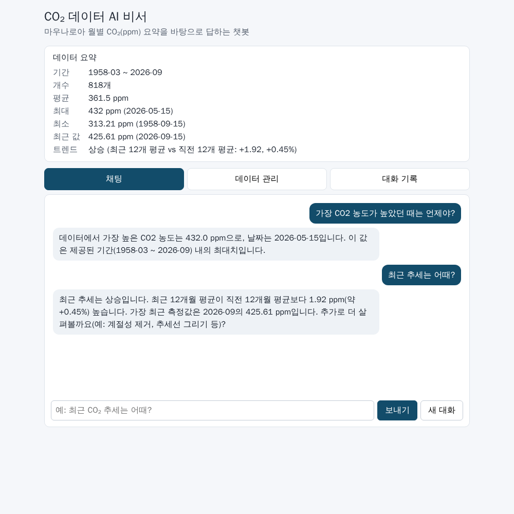

# 마우나로아 CO₂ 데이터 AI 비서

마우나로아 월별 CO₂ 시계열(실측 818개)을 요약해 GPT 시스템 프롬프트에 주입하고, 내 데이터를 아는 채팅 서비스를 제공합니다. 일반 ChatGPT는 "최근 CO₂ 추세는?"에 일반론만 답하지만, 이 서비스는 저장된 데이터의 기간·평균·최대/최소·최근 추세를 근거로 답합니다.

## 기술 스택

- 백엔드: FastAPI, Pydantic, Firebase Firestore(firebase-admin), OpenAI API, python-dotenv, uvicorn
- 프론트엔드: 바닐라 HTML/CSS/JavaScript
- 배포: Render(백엔드), Vercel(프론트엔드)

## 배포 URL (배포 후 채워 넣기)

| 구분 | URL |
|---|---|
| 프론트엔드 | https://(your-app).vercel.app |
| 백엔드 API | https://(your-api).onrender.com |
| Swagger UI | https://(your-api).onrender.com/docs |

> Render 무료 티어는 15분 미사용 시 잠들어 첫 요청이 최대 1분 걸립니다. 프론트는 3초 넘게 응답이 없으면 "서버를 깨우는 중" 안내를 표시합니다.

## 로컬 실행

```bash
# 1) 백엔드 (Python 3.10+)
cd backend
python -m venv .venv && source .venv/bin/activate   # Windows: .venv\Scripts\Activate.ps1
pip install -r requirements.txt
cp .env.example .env                                  # 값 채우기
python scripts/seed_firestore.py                      # 최초 1회: 데이터 818개 적재
uvicorn main:app --reload                             # http://localhost:8000/docs

# 2) 프론트엔드 (다른 터미널)
cd frontend
python -m http.server 5500                            # http://localhost:5500

# (선택) 키 없이 화면·API 점검: 메모리 DB + 가짜 GPT 응답
cd backend && python dev_server.py   # 프론트는 위 2)와 동일

# 테스트 (Firestore/OpenAI 는 mock, pip install -r requirements-dev.txt 필요)
cd backend && python -m unittest discover -s tests -t .
```

## 환경 변수

| 이름 | 위치 | 설명 |
|---|---|---|
| `OPENAI_API_KEY` | 백엔드 | OpenAI 키 |
| `FIREBASE_SERVICE_ACCOUNT_JSON` | 백엔드 | 서비스 계정 키 JSON 문자열 전체 또는 파일 경로 |
| `ALLOWED_ORIGINS` | 백엔드 | CORS 허용 도메인, 쉼표 구분 (예: 프론트 Vercel URL) |
| `OPENAI_MODEL` | 백엔드(선택) | 기본 `gpt-5-mini` |
| `OPENAI_BASE_URL` | 백엔드(선택) | OpenAI 호환 프록시 주소 (비우면 OpenAI 공식) |
| `OPENAI_MAX_TOKENS` | 백엔드(선택) | 기본 `1500` (`max_completion_tokens`, 추론 토큰 포함 · 과금 방지) |
| `API_BASE_URL` | 프론트(Vercel) | 백엔드 주소. 빌드 시 `config.js` 로 기록됨 |

키는 코드에 넣지 않고 `.env`(git 제외) 또는 배포 서비스의 환경변수로만 설정합니다. CORS 는 브라우저가 허용된 프론트 도메인의 요청만 통과시키기 위해 필요합니다.

## API

- 데이터: `POST/GET /api/data`, `PUT/DELETE /api/data/{id}`, `GET /api/data/summary`
- 대화: `POST/GET /api/conversations`, `GET/DELETE /api/conversations/{id}`
  - 목록(`GET`)은 `messages` 를 **포함하지 않고** `message_count` 만 반환, 불러오기는 `GET /{id}` 로 전체 messages 조회
- 채팅: `POST /api/chat` — 요약 조회 → 시스템 프롬프트 삽입 → GPT 호출 → conversations 자동 저장

## 구조

```text
backend/
  main.py            앱·CORS·라우터 등록
  routers/           data, conversations, chat (HTTP 처리)
  services/          summary(요약 계산), llm(프롬프트 주입), repository·firebase(Firestore)
  schemas.py         Pydantic 검증
  scripts/           Firestore 시드
  tests/
frontend/            index.html, style.css, app.js, config.js, build-config.js
```

Firestore: `data/{id}` = `{date, value, memo}`, `conversations/{id}` = `{title, messages[], created_at, updated_at}`. `value` 는 실측 CO₂(ppm)이며 결측·제공처 보간 월은 넣지 않았습니다.

## 배포 절차

1. GitHub 에 푸시 (이 폴더가 repo 하위면 Root Directory 로 지정)
2. Render → New Web Service: Root Directory `M1-2/backend`, Build `pip install -r requirements.txt`, Start `uvicorn main:app --host 0.0.0.0 --port $PORT`, 환경변수 위 표 입력(`ALLOWED_ORIGINS` 에 Vercel URL)
3. Vercel → Root Directory `M1-2/frontend`, 환경변수 `API_BASE_URL`=Render URL (빌드 명령은 `vercel.json` 에 지정됨)

## 제출 스크린샷

**1. 데이터 요약이 보이는 채팅 화면 (질문 + 답변)**



**2. 데이터 관리 화면 (추가 → 수정 CRUD 동작)**


**3. 대화 기록 화면 (목록 → 불러오기)**


> 로컬 실행 화면입니다. 배포 후 배포 URL 화면으로 교체하세요.

---

# 부록: CO₂ 시계열 분석 (기존 과제)

Scripps 마우나로아 월별 CO₂ 기록(1958–2026)으로 장기 증가 속도, 계절 진폭, 2024년 증가량을 분석.

**전체 분석: [REPORT.md](REPORT.md)** / 발표 자료: `presentation.html`을 브라우저에서 열기

## 실행

Python 3.10 이상 (검증: 3.13)

```bash
python -m venv .venv
source .venv/bin/activate      # Windows: .venv\Scripts\Activate.ps1
python -m pip install -r requirements-lock.txt
python run_analysis.py
```

- `run_analysis.py`: 보관된 원본으로 분석 → `REPORT.md`·`presentation.html` 생성 → 테스트 순서로 실행
- 다른 Python 버전: `requirements.txt` 사용
- 원본 새로 받기: `python src/collect_data.py --download`

## 데이터

- 원본: `data/raw/monthly_in_situ_co2_mlo.csv` ([출처·컬럼·결측 처리](data/SOURCE.md))
- 라이선스: Scripps CO₂ Program, UC San Diego, CC BY 4.0 (코드에는 미적용)

## 구성

```text
REPORT.md          # 제출 보고서
src/               # 수집·분석·보고서·발표 생성 코드
data/              # 원본과 중간 산출물
images/            # 그래프
results/           # 정량 지표(JSON)·검증 기록
tests/             # 자동 테스트
```
