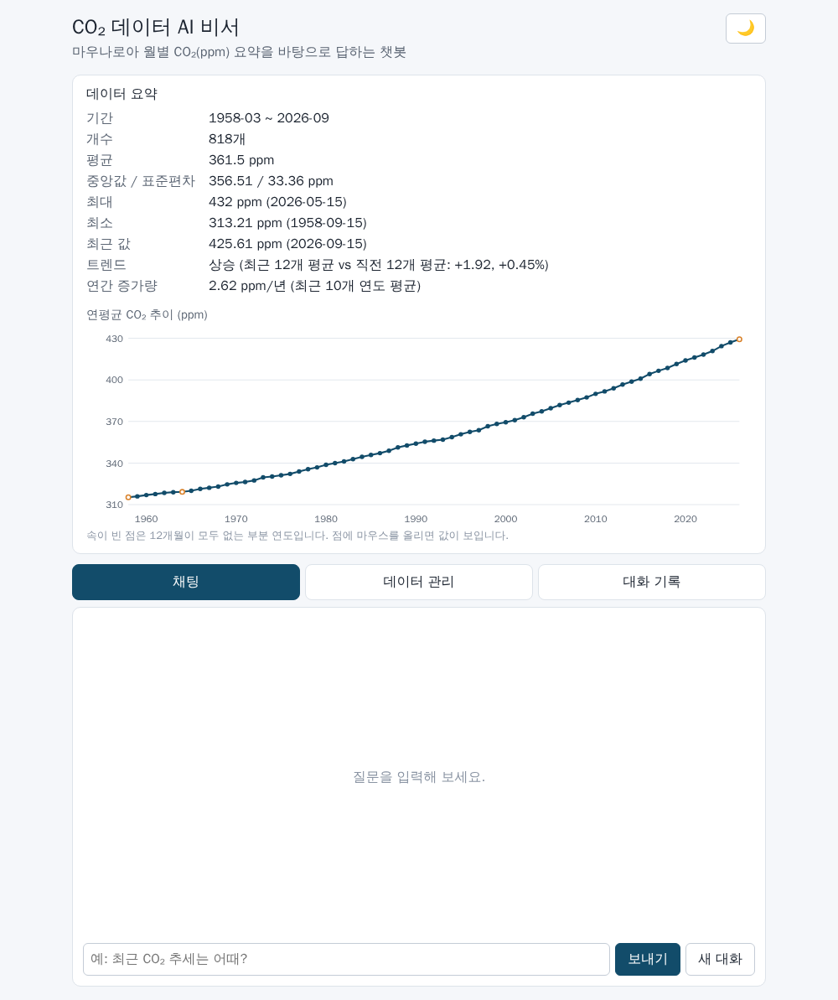
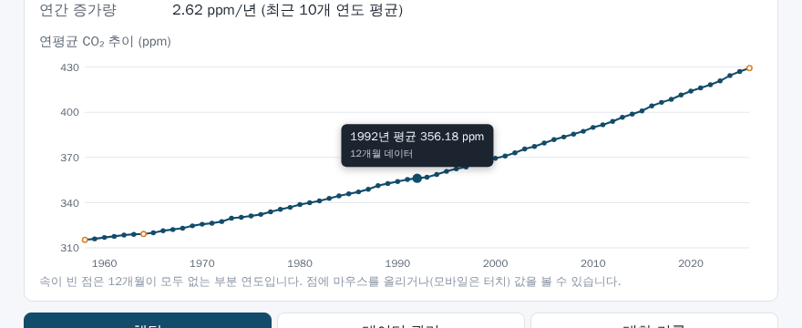
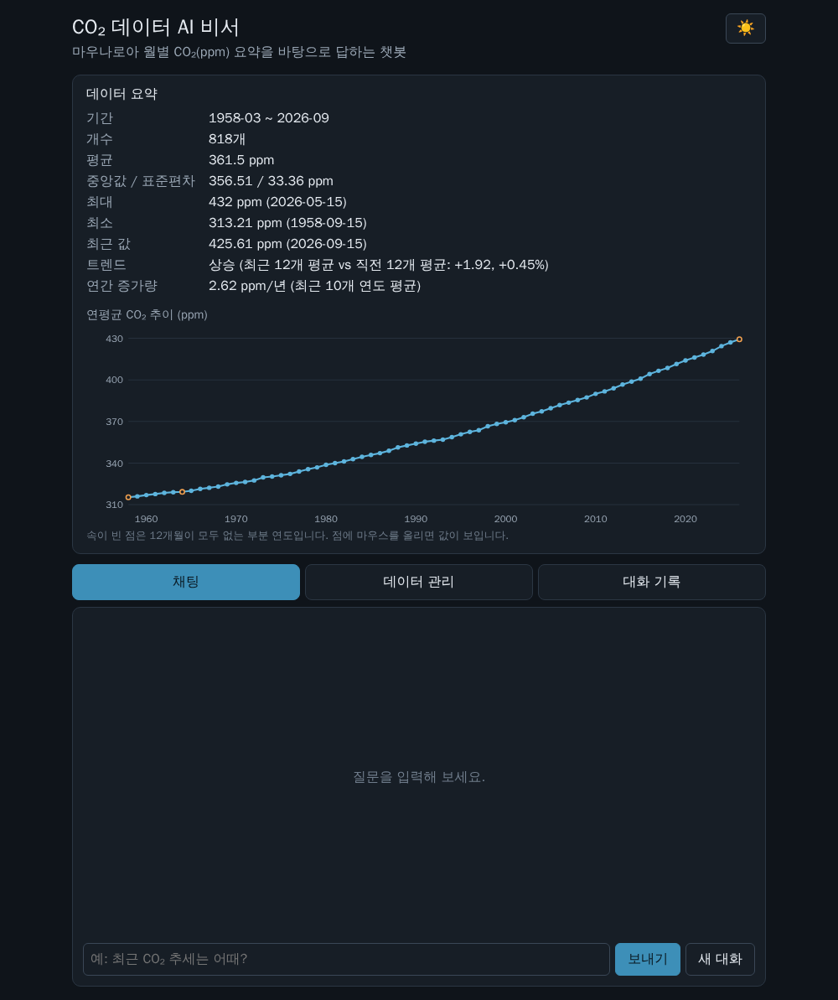
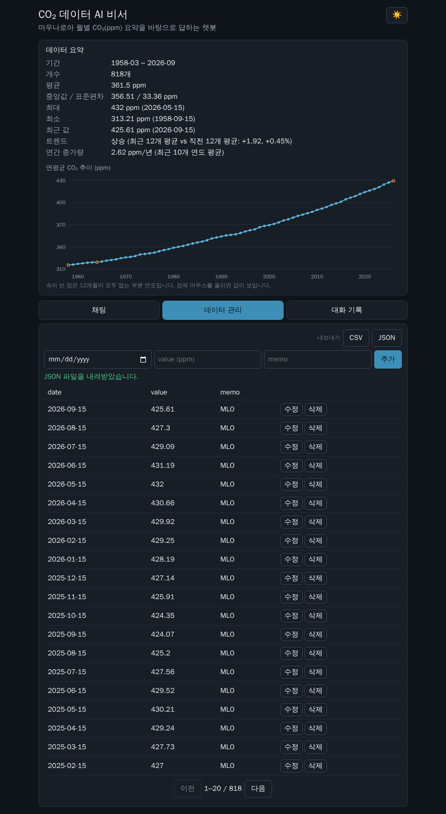
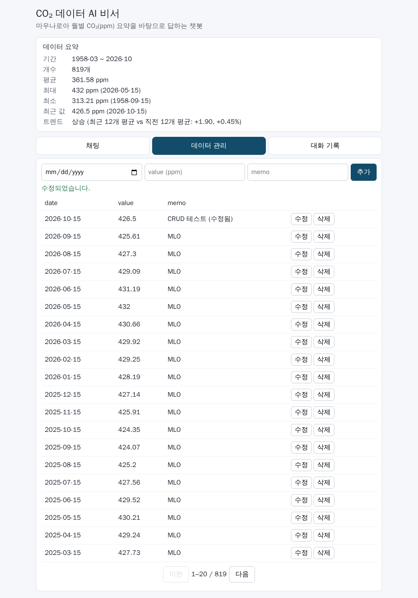
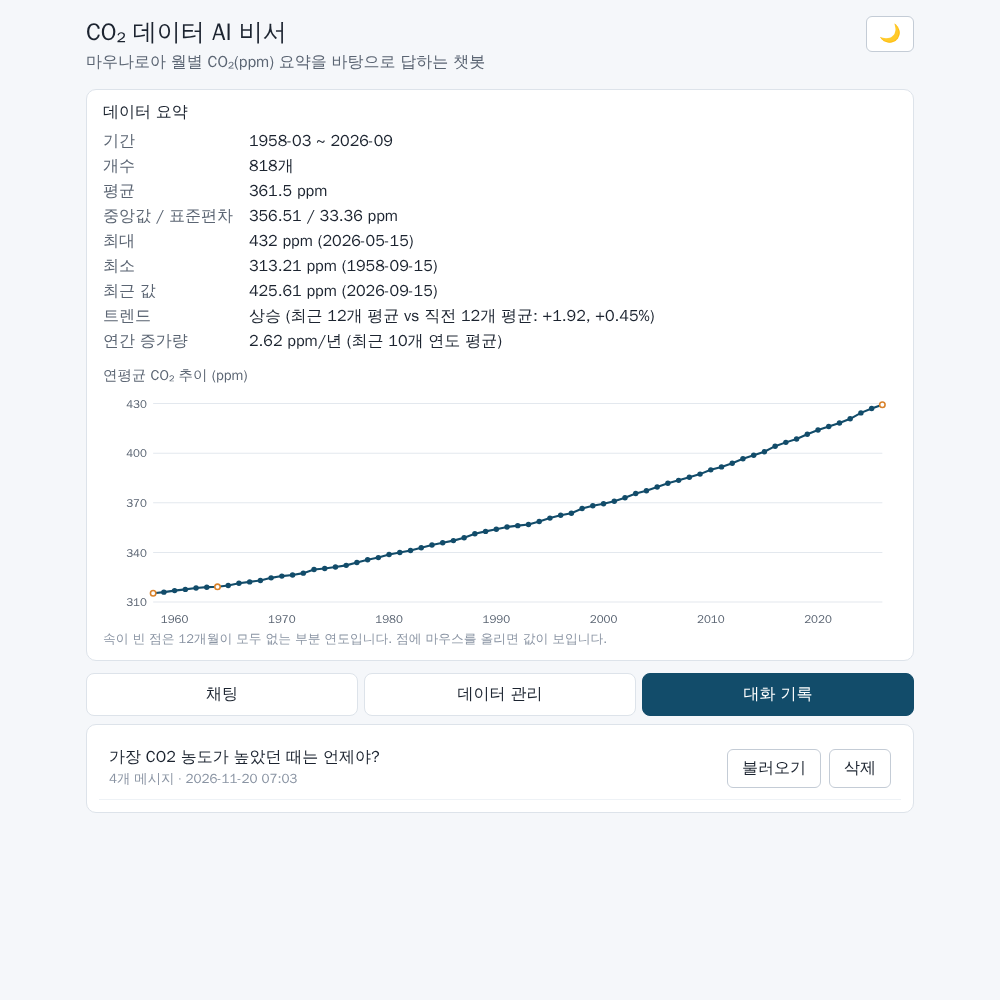

# 마우나로아 CO₂ 데이터 AI 비서

마우나로아 월별 CO₂ 시계열(실측 818개)을 요약해 GPT 시스템 프롬프트에 주입하고, 내 데이터를 아는 채팅 서비스를 제공합니다. 일반 ChatGPT는 "최근 CO₂ 추세는?"에 일반론만 답하지만, 이 서비스는 저장된 데이터의 기간·평균·최대/최소·최근 추세를 근거로 답합니다.

## 기술 스택

- 백엔드: FastAPI, Pydantic, Firebase Firestore(firebase-admin), OpenAI API, python-dotenv, uvicorn
- 프론트엔드: 바닐라 HTML/CSS/JavaScript
- 배포: Render(백엔드), Vercel(프론트엔드)

## 배포 URL (배포 후 채워 넣기)

| 구분 | URL |
|---|---|
| 프론트엔드 | https://co2-ai-assistant.vercel.app |
| 백엔드 API | https://co2-ai-assistant-api.onrender.com |
| Swagger UI | https://co2-ai-assistant-api.onrender.com/docs |

> Render 무료 티어는 15분 미사용 시 잠들어 첫 요청이 최대 1분 걸립니다. 프론트는 3초 넘게 응답이 없으면 "서버를 깨우는 중" 안내를 표시합니다.

## 로컬 실행

```bash
# 1) 백엔드 (Python 3.10+)
cd backend
python -m venv .venv && source .venv/bin/activate   # Windows: .venv\Scripts\Activate.ps1
pip install -r requirements.txt
cp .env.example .env                                  # 값 채우기
python scripts/seed_firestore.py                      # 최초 1회: 데이터 818개 적재
uvicorn main:app --reload                             # http://localhost:8000/docs

# 2) 프론트엔드 (다른 터미널)
cd frontend
python -m http.server 5500                            # http://localhost:5500

# (선택) 키 없이 화면·API 점검: 메모리 DB + 가짜 GPT 응답
cd backend && python dev_server.py   # 프론트는 위 2)와 동일

# 테스트 (Firestore/OpenAI 는 mock, pip install -r requirements-dev.txt 필요)
cd backend && python -m unittest discover -s tests -t .
```

## 환경 변수

| 이름 | 위치 | 설명 |
|---|---|---|
| `OPENAI_API_KEY` | 백엔드 | OpenAI 키 |
| `FIREBASE_SERVICE_ACCOUNT_JSON` | 백엔드 | 서비스 계정 키 JSON 문자열 전체 또는 파일 경로 |
| `ALLOWED_ORIGINS` | 백엔드 | CORS 허용 도메인, 쉼표 구분 (예: 프론트 Vercel URL) |
| `OPENAI_MODEL` | 백엔드(선택) | 기본 `gpt-5.4` (프록시 차감 배수 1). 더 강한 `gpt-5.5`(배수 2)나 저렴한 `gpt-5-mini`(0.5)로 교체 가능 |
| `BRIEFING_MODEL` / `BRIEFING_MAX_TOKENS` | 백엔드(선택) | 브리핑 전용 모델(기본: `OPENAI_MODEL`) / 토큰 상한(기본 `1200`) |
| `HISTORY_MAX_CHARS` | 백엔드(선택) | 이전 대화를 다시 보낼 때의 총 글자 한도(기본 `4000`) |
| `OPENAI_BASE_URL` | 백엔드(선택) | OpenAI 호환 프록시 주소 (비우면 OpenAI 공식) |
| `OPENAI_MAX_TOKENS` | 백엔드(선택) | 기본 `1500` (`max_completion_tokens`, 추론 토큰 포함 · 과금 방지) |
| `API_BASE_URL` | 프론트(Vercel) | 백엔드 주소. 빌드 시 `config.js` 로 기록됨 |

키는 코드에 넣지 않고 `.env`(git 제외) 또는 배포 서비스의 환경변수로만 설정합니다. CORS 는 브라우저가 허용된 프론트 도메인의 요청만 통과시키기 위해 필요합니다.

## API

- 데이터: `POST/GET /api/data`, `PUT/DELETE /api/data/{id}`, `GET /api/data/summary`
- 대화: `POST/GET /api/conversations`, `GET/DELETE /api/conversations/{id}`
  - 목록(`GET`)은 `messages` 를 **포함하지 않고** `message_count` 만 반환, 불러오기는 `GET /{id}` 로 전체 messages 조회
- 보너스: `GET /api/data/statistics`(연평균 시계열 · 연간 증가량), `GET /api/data/export?format=csv|json`(다운로드)
- 채팅: `POST /api/chat` — 요약 조회 → 시스템 프롬프트 삽입 → GPT 호출(필요 시 도구 호출) → conversations 자동 저장. 응답에 `tools_used`, `usage` 포함
- 최신화: `GET /api/briefing`(오늘의 AI 브리핑), `POST /api/data/refresh`(Scripps 원본에 새 달이 있으면 추가, 10분 쿨다운)

## 구조

```text
backend/
  main.py            앱·CORS·라우터 등록
  routers/           data, conversations, chat (HTTP 처리)
  services/          summary(요약 계산), llm(프롬프트 주입), repository·firebase(Firestore)
  schemas.py         Pydantic 검증
  scripts/           Firestore 시드
  tests/
frontend/            index.html, style.css, app.js, config.js, build-config.js
```

Firestore: `data/{id}` = `{date, value, memo}`, `conversations/{id}` = `{title, messages[{role, content, tools[]}], created_at, updated_at}`, `briefings/{관측일}` = `{text, facts[], ai, model, ...}`(새 관측일당 1건). `value` 는 실측 CO₂(ppm)이며 결측·제공처 보간 월은 넣지 않았습니다.

## 최신화와 AI 활용 (오늘의 브리핑 · 도구 호출)

월별 자료(Scripps)는 1~2개월 늦어서 "오늘"을 말할 수 없습니다. 같은 관측소의 **NOAA GML 일별 자료**(최신 관측일이 보통 1~2일 전)를 보조 출처로 씁니다. 일별 값은 방법이 달라 월별과 조금 다르고, NOAA가 *최근 몇 달은 잠정치*라고 밝히므로 화면과 답변에 "잠정치"를 표시합니다.

| 구분 | 출처 | 갱신 |
|---|---|---|
| 월별 (Firestore `data`) | Scripps CO₂ Program, UC San Diego (CC BY 4.0) | `POST /api/data/refresh` 로 새 달만 추가(기존·수동 입력은 덮어쓰지 않음) |
| 일별 (서버 메모리, 6시간 캐시) | NOAA GML 마우나로아 일별 (`co2_daily_mlo.csv`) | 요청 시 내려받아 캐시. 전체를 DB에 올리지 않음(무료 한도 보호) |

### 오늘의 AI 브리핑 (`GET /api/briefing`)
- **사실은 코드가 계산**합니다(`services/daily.py`): 전일 대비, 7·30일 평균, 30일 최고/최저, 전년 동기 대비와 그 z-점수, 일간 변동 이상치, 자료 지연. GPT는 이 사실만 서술하며 숫자·원인을 지어내지 않도록 제한했습니다.
- **새 관측일이 올라올 때 하루 1회만** GPT를 호출하고 `briefings/{관측일}` 에 저장합니다. 이후 요청은 메모리/DB에서 응답하므로 비용이 거의 없습니다(서버가 잠들어도 안전한 "첫 요청 시 생성" 방식).
- GPT 실패 시 계산된 사실로 대체 문구를 보여 주고(`ai: false`), 저장하지 않아 다음 요청에서 다시 시도합니다.
- 화면의 "근거" 접기 영역에서 계산된 사실을 그대로 볼 수 있습니다.

### 챗봇 도구 호출 (Function Calling)
GPT가 필요할 때만 내부 기능을 호출합니다. 호출 기록은 답변 아래(🔧)에 표시되고 대화와 함께 저장됩니다.

| 도구 | 언제 호출하나 (근거) | 예시 질문 |
|---|---|---|
| `get_recent_daily(days)` | 요약에 없는 최신·최근 며칠 값 | "어제 농도는?", "최근 3일 어때?" |
| `get_today_highlights()` | 특이사항 판단 (계산 결과를 그대로 반환) | "오늘 특이사항 있어?" |
| `get_monthly_range(start, end)` | 특정 월·기간 값 (요약에는 통계만 있음) | "2019년 5월 농도는?", "2020년 최고 달은?" |
| (호출 안 함) | 시스템 프롬프트의 월별 요약으로 답할 수 있음 | "관측 이래 가장 높았던 달은?" |

```text
사용자 질문
  └▶ POST /api/chat
       1. 월별 요약 계산 (캐시)                → 시스템 프롬프트에 주입
       2. GPT 호출 (요약 + 이전 대화 + 도구 스키마)
            ├─ 답할 수 있음 ───────────────────▶ 3. 응답
            └─ tool_calls ▶ 서버가 인자 검증 후 실행 ▶ 결과를 GPT에 전달 ▶ (2 반복, 최대 3회)
       3. 응답 + tools_used + usage 반환, 대화(도구 기록 포함) 자동 저장
```

안전장치: 도구 인자는 모델이 만든 값이라 신뢰하지 않고 검증합니다(월 형식, 일수 1~30 보정, 알 수 없는 도구/잘못된 JSON은 오류 문자열로 반환). 도구는 읽기 전용이며 왕복은 3회로 제한하고, 마지막 왕복은 도구 없이 답하게 강제합니다. 모델이 오늘 날짜를 모르면 "어제 값"을 잘못 말하므로, 시스템 프롬프트에 오늘 날짜(KST)와 "자료는 1~2일 늦다" 규칙을 넣고 도구 결과에도 최신 관측일과 지연 일수를 포함합니다. (실제로 이 보정 전에는 11-17 값을 "어제"라고 답하는 오류가 있었습니다.)

> 구현한 것은 *Function Calling* 입니다. 같은 기능을 MCP Server / GPT Actions 로 노출하는 외부 채널 연동은 하지 않았습니다.

### 컨텍스트 최적화
1. **상시 필요한 것만 주입, 나머지는 도구로 조회**: 월별 요약만 시스템 프롬프트에 넣고 최신·기간 데이터는 필요할 때만 가져옵니다.
2. **고정 지침을 앞에, 바뀌는 데이터를 뒤에** 두어 프롬프트 접두 캐시에 유리하게 했습니다.
3. **이전 대화 예산**: 최근 10개, 총 4000자 이내, 오래된 긴 답변은 800자로 자르고 최신 질문은 보존. 도구 기록 등 부가 필드는 모델에 보내지 않습니다.
4. 도구 결과는 압축 JSON + 2500자 상한, 도구 왕복 3회 상한, 브리핑은 관측일당 1회.
5. 서버 메모리 캐시로 Firestore 읽기를 줄였습니다(아래 참고).

실측(프록시가 보고한 입력 토큰, 같은 질문 "안녕" 기준):

| 구성 | 입력 토큰 |
|---|---|
| 이전 프롬프트(월별 요약만) | 293 |
| 최신 90일 일별 데이터를 **매번 프롬프트에 주입**하는 단순 방식 | 986 |
| **현재**: 프롬프트 + 도구 스키마 (최신 데이터가 필요 없는 질문) | 635 (단순 방식 대비 **36% 감소**) |
| 긴 답변이 쌓인 24개 메시지 대화를 전부 재전송 → 예산 적용 | 7,795 → 2,436 (**69% 감소**) |

프롬프트 본문 자체는 이전(293)보다 355로 *늘었습니다*. 오늘 날짜, 지연 규칙, 중앙값·표준편차·연간 증가량을 더했기 때문입니다. 절감은 "필요한 데이터를 매번 넣지 않는 구조"와 "대화 이력 예산"에서 나옵니다. 도구가 호출되면 왕복마다 시스템 프롬프트와 스키마를 다시 보내므로 해당 질문은 1,400~2,000 토큰이 듭니다.

### Firestore 무료 한도 주의
`data` 전체(약 800문서)를 요청마다 읽으면 하루 5만 읽기 한도를 금방 넘깁니다(실제로 한 번 초과해 서비스가 503이 났습니다). 그래서 서버 메모리에 1시간 캐시하고(쓰기 시 즉시 무효화), 한도 초과 시 오래된 캐시로 응답하거나 CORS 헤더가 유지되는 503 + 안내 문구를 반환합니다.

## 배포 절차

1. GitHub 에 푸시 (이 폴더가 repo 하위면 Root Directory 로 지정)
2. Render → New Web Service: Root Directory `M1-2/backend`, Build `pip install -r requirements.txt`, Start `uvicorn main:app --host 0.0.0.0 --port $PORT`, 환경변수 위 표 입력(`ALLOWED_ORIGINS` 에 Vercel URL)
3. Vercel → Root Directory `M1-2/frontend`, 환경변수 `API_BASE_URL`=Render URL (빌드 명령은 `vercel.json` 에 지정됨)

## 보너스 과제 (인사이트 · UX 고도화)

| 항목 | 구현 |
|---|---|
| 추가 지표 | `/api/data/summary` 의 `metrics` 에 `median`, `stdev`, `recent_annual_growth_ppm`(12개월이 모두 있는 연속 연도 기준 최근 최대 10개 연간 증가량 평균) 추가. `/api/data/statistics` 는 연평균·연간 증가량 목록을 반환. 요약에 들어가므로 GPT 답변에도 반영됨 |
| 시각화 | 연평균 CO₂ 추이 그래프 1개 (바닐라 SVG, 라이브러리 없음). 12개월 미만인 부분 연도는 속이 빈 점으로 표시. 점에 마우스를 올리면(모바일은 터치) 연도·평균·개월 수 툴팁 표시 |
| 내보내기 | 데이터 탭의 CSV / JSON 버튼 → `GET /api/data/export`. CSV 는 엑셀 한글 깨짐 방지(BOM)와 수식 주입 방지(`=`,`+`,`-`,`@` 시작 셀에 `'` 접두) 적용 |
| 다크 모드 | 우측 상단 토글. 저장된 선택 → 시스템 설정 순으로 초기 테마 결정, 첫 페인트 전에 적용해 깜빡임 없음 |

연간 증가량은 부분 연도를 비교에서 제외합니다(예: 1958·2026년). 2024년 증가량 3.58 ppm 등 `REPORT.md` 의 분석값과 일치합니다.






## 제출 스크린샷

**1. 데이터 요약이 보이는 채팅 화면 (질문 + 답변)**


**2. 데이터 관리 화면 (추가 → 수정 CRUD 동작)**



**3. 대화 기록 화면 (목록 → 불러오기)**




> 배포된 프론트(Vercel) 화면에서 촬영했습니다.

---

# 부록: CO₂ 시계열 분석 (기존 과제)

Scripps 마우나로아 월별 CO₂ 기록(1958–2026)으로 장기 증가 속도, 계절 진폭, 2024년 증가량을 분석.

**전체 분석: [REPORT.md](REPORT.md)** / 발표 자료: `presentation.html`을 브라우저에서 열기

## 실행

Python 3.10 이상 (검증: 3.13)

```bash
python -m venv .venv
source .venv/bin/activate      # Windows: .venv\Scripts\Activate.ps1
python -m pip install -r requirements-lock.txt
python run_analysis.py
```

- `run_analysis.py`: 보관된 원본으로 분석 → `REPORT.md`·`presentation.html` 생성 → 테스트 순서로 실행
- 다른 Python 버전: `requirements.txt` 사용
- 원본 새로 받기: `python src/collect_data.py --download`

## 데이터

- 원본: `data/raw/monthly_in_situ_co2_mlo.csv` ([출처·컬럼·결측 처리](data/SOURCE.md))
- 라이선스: Scripps CO₂ Program, UC San Diego, CC BY 4.0 (코드에는 미적용)

## 구성

```text
REPORT.md          # 제출 보고서
src/               # 수집·분석·보고서·발표 생성 코드
data/              # 원본과 중간 산출물
images/            # 그래프
results/           # 정량 지표(JSON)·검증 기록
tests/             # 자동 테스트
```
